# Arquitecturas Modernas de Ingeniería de Datos, FinOps y Motores Declarativos de Reverse ETL

**Subtítulo:** Tratado Técnico de Diseño Físico, Gobierno Criptográfico, Resiliencia Distribuida y Activación Operativa de Datos (Referencia Arquitectónica del Motor `data-pulse`)  
**Autoría:** Darwin Miguel Abarca Vargas — Senior Data Engineer & Quantitative Economist  
**Clasificación:** Manual de Ingeniería de Sistemas de Datos y Especificación de Arquitectura  
**Versión:** 1.0.0  

---

## Resumen Ejecutivo (Abstract)

El presente tratado establece los fundamentos teóricos, matemáticos y prácticos de la Ingeniería de Datos moderna a escala corporativa. A través de nueve módulos progresivos, se aborda la transición desde la concepción organizacional y el control financiero en la nube (Cloud FinOps) hasta la implementación física de almacenes analíticos columnares (Snowflake, DuckDB, BigQuery, Databricks), el modelado dimensional histórico (Kimball y Slowly Changing Dimensions), la seguridad criptográfica bajo el paradigma de Confianza Cero (Zero Trust) y la ingeniería de resiliencia en sistemas distribuidos. 

Como caso de estudio central y aporte al ecosistema de código abierto, se documenta la arquitectura de **`data-pulse`**: un motor declarativo y sin interfaz pesada (Headless) de Reverse ETL que sincroniza indicadores económicos y financieros desde almacenes de datos hacia plataformas operativas (CRMs comerciales como HubSpot y Webhooks corporativos), orquestado mediante Apache Airflow sobre contenedores Docker, con un núcleo de extracción e inteligencia operativa en Python y conectores de validación estricta en TypeScript.

---

## Tabla de Contenidos

1. [Módulo 1: El Ecosistema Corporativo, FinOps y el ADN del Senior Data Engineer](#1-el-ecosistema-corporativo-finops-y-el-adn-del-senior-data-engineer)
2. [Módulo 2: El Flujo de Desarrollo: Del Ecosistema Web a los Sistemas de Datos y Dirección de IA](#2-el-flujo-de-desarrollo-del-ecosistema-web-a-los-sistemas-de-datos-y-direccion-de-ia)
3. [Módulo 3: Inmersión en Snowflake, Simulación Local con DuckDB y Transformación con dbt](#3-inmersion-en-snowflake-simulacion-local-con-duckdb-y-transformacion-con-dbt)
4. [Módulo 4: Arquitectura en Acción: Orquestación en Airflow, Resiliencia y Diagnóstico Asistido (`data-pulse`)](#4-arquitectura-en-accion-orquestacion-en-airflow-resiliencia-y-diagnostico-asistido-data-pulse)
5. [Módulo 5: Diseño Físico de Datos, Rendimiento SQL Interno y FinOps en Profundidad](#5-diseno-fisico-de-datos-rendimiento-sql-interno-y-finops-en-profundidad)
6. [Módulo 6: Modelado Dimensional Avanzado (SCD) y Evolución de Esquemas (Data Contracts)](#6-modelado-dimensional-avanzado-scd-y-evolucion-de-esquemas-data-contracts)
7. [Módulo 7: Seguridad Corporativa, Criptografía Aplicada a Datos y Gobernanza (SecOps)](#7-seguridad-corporativa-criptografia-aplicada-a-datos-y-gobernanza-secops)
8. [Módulo 8: Arquitectura de Datos Moderna Comparada: El Criterio del Arquitecto](#8-arquitectura-de-datos-moderna-comparada-el-criterio-del-arquitecto)
9. [Módulo 9: CI/CD para Datos, Despliegue a Producción, Entregables Ejecutivos y Supervivencia en Producción](#9-cicd-para-datos-despliegue-a-produccion-entregables-ejecutivos-y-supervivencia-en-produccion)

---

# 1. El Ecosistema Corporativo, FinOps y el ADN del Senior Data Engineer

La Ingeniería de Datos contemporánea ha dejado de ser una disciplina auxiliar encargada de mover archivos entre servidores para convertirse en la columna vertebral financiera y operativa de las organizaciones. En un entorno donde las decisiones de fijación de precios, asignación de capital, auditoría de activos y retención de clientes dependen de la latencia y veracidad del dato, el Ingeniero de Datos Sénior actúa en la intersección entre la arquitectura de sistemas distribuidos y la eficiencia económica.

## 1.1. Topología Organizacional: Startup vs. Corporación (Enterprise)

La estructura de responsabilidades, el grado de especialización y las métricas de evaluación de un Ingeniero de Datos varían sustancialmente en función de la madurez organizacional, el volumen transaccional y el marco regulatorio de la empresa.

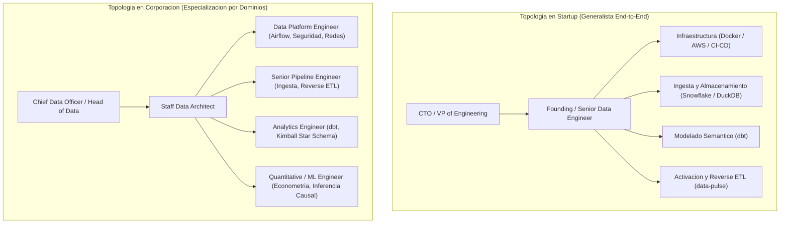

### A. Dinámica en una Startup (Etapas Seed a Serie B): El "Founding / Full-Stack Data Engineer"
En organizaciones jóvenes o de crecimiento acelerado, la estructura jerárquica es horizontal. El ingeniero reporta directamente al Director de Tecnología (CTO) o al Vicepresidente de Ingeniería. No existen departamentos aislados para la administración de bases de datos o mantenimiento de plataformas.
1. **Alcance de Extremo a Extremo (End-to-End Ownership):** El ingeniero es responsable de todo el ciclo de vida del dato: desde el aprovisionamiento de contenedores Docker y permisos en la nube (AWS IAM), pasando por la extracción de bases de datos transaccionales de producción (PostgreSQL) y la transformación analítica en Snowflake con dbt, hasta la inyección de indicadores calculados en las herramientas comerciales mediante motores de Reverse ETL como `data-pulse`.
2. **Métrica Primaria de Éxito:** Velocidad de entrega de valor al negocio (*Time-to-Value*) combinada con una contención estricta del gasto en infraestructura (evitar costos fijos elevados en licencias SaaS de terceros mediante soluciones propias auto-alojadas y eficientes).

### B. Dinámica en una Corporación o Scale-Up (Serie C+, Banca, Fintech, Retail): Especialización Estratificada
En organizaciones con cientos de millones de registros diarios y estrictas auditorías regulatorias, el equipo de datos se divide en niveles jerárquicos (*Junior, Mid, Senior, Staff y Principal Data Engineer*) y se segrega funcionalmente en dos vertientes técnicas:
1. **Data Platform Engineering (Ingeniería de Plataforma):** Equipos dedicados a construir y blindar la infraestructura base. Administran el clúster corporativo de Apache Airflow, definen la topología de redes privadas, gestionan el control de acceso basado en roles (RBAC) en Snowflake y desarrollan librerías internas estandarizadas.
2. **Data Product & Pipeline Engineering (Ingeniería de Flujos y Producto):** Equipos integrados dentro de dominios de negocio específicos (Finanzas, Riesgos, Comercial). Utilizan la plataforma central para construir tuberías de datos resilientes, garantizar el cumplimiento de los acuerdos de nivel de servicio (SLAs) y asegurar la trazabilidad contable del dato desde su origen hasta los sistemas de destino.
3. **Métrica Primaria de Éxito:** Fiabilidad operativa (*Reliability*), cumplimiento normativo (GDPR, normativas bancarias), escalabilidad horizontal, observabilidad proactiva y cero tiempo de inactividad (*Zero Downtime*).

---

## 1.2. Taxonomía de Roles en un Equipo de Datos: Fronteras de Código y Negocio

El trabajo diario de un Ingeniero de Datos Sénior requiere una coordinación precisa con perfiles técnicos y no técnicos. Comprender las fronteras de responsabilidad evita cuellos de botella operativos y duplicidad de esfuerzos.

### A. Roles con Intervención Directa en Código de Producción

| Rol Técnico | Responsabilidad Arquitectónica Principal | Tecnologías Dominantes | Interacción con el Senior Data Engineer |
| :--- | :--- | :--- | :--- |
| **Data Architect** | Diseño macroscópico del ecosistema, selección de proveedores Cloud, estándares de seguridad global y gobierno de metadatos. | Diagramación C4, Terraform, AWS/GCP/Azure, Snowflake Governance. | Define las restricciones de seguridad y topología sobre las cuales el Data Engineer construye los sistemas. |
| **Senior Data Engineer** | Construcción de motores de ingesta masiva, orquestación distribuida, optimización física de bases de datos y activación operativa (Reverse ETL). | Python (Polars/PySpark), SQL avanzado, TypeScript, Airflow, Docker, Snowflake. | Núcleo constructor. Entrega infraestructura de datos automatizada, idempotente y auditada. |
| **Analytics Engineer** | Transformación de datos crudos en modelos dimensionales limpios (Metodología Kimball) y mantenimiento de la capa semántica de métricas. | dbt Core, SQL analítico, Jinja, GitHub Actions (Slim CI). | Consume las tablas crudas depositadas por el Data Engineer y genera las tablas finales (`Marts`) que lee `data-pulse`. |
| **Machine Learning / Quantitative Engineer** | Diseño y entrenamiento de modelos predictivos, econometría avanzada e inferencia causal (ej. elasticidad precio mediante Double Machine Learning). | Python (EconML, DoWhy, Scikit-Learn), Databricks, PySpark, MLflow. | Depende del Data Engineer para recibir variables limpias a tiempo y para desplegar los puntajes del modelo hacia los CRMs. |
| **DevOps / Cloud Infrastructure Engineer** | Administración de redes virtuales (VPC), clústeres de Kubernetes/ECS, cortafuegos perimetrales y registros de contenedores. | Linux, Docker, Kubernetes, Terraform, GitHub Actions, Coolify. | Provee el servidor o clúster seguro; sin embargo, no interviene en la optimización de consultas SQL ni en el gasto interno de créditos de Snowflake. |

### B. Roles sin Intervención en Código de Infraestructura (Consumidores y Gobierno)

1. **Data Analyst / Business Intelligence (BI) Developer:**
   Consumen las tablas analíticas finales en Snowflake para construir cuadros de mando ejecutivos (PowerBI, Tableau, Looker) y realizar análisis descriptivos. Aunque utilizan SQL de lectura, no gestionan contenedores Docker, ni orquestadores como Airflow, ni despliegues en Git. Esperan del Ingeniero de Datos tablas puntuales, documentadas y libres de duplicados a primera hora de la mañana.
2. **Data Product Manager (DPM) / Product Owner:**
   Actúan como interfaz entre los directivos de la empresa y el equipo técnico. Traducen objetivos estratégicos en requerimientos funcionales y priorizan la lista de trabajo (*Backlog*). No escriben código; esperan del Ingeniero de Datos estimaciones de esfuerzo precisas y análisis de costo-beneficio (*Trade-offs*).
3. **Data Steward / Data Governance Lead:**
   Custodios del cumplimiento legal, la privacidad (PII) y el diccionario corporativo de datos. Dictan qué columnas deben ser enmascaradas o encriptadas antes de ser consultadas por analistas o enviadas hacia APIs externas.
4. **Stakeholders Ejecutivos (CFO, VP of Sales, CMO):**
   Usuarios finales del valor económico del dato. Al Director Comercial no le interesa la complejidad interna de Apache Airflow o Snowflake; su requerimiento es abrir HubSpot o Salesforce cada mañana y encontrar actualizado el indicador de rentabilidad neta y el resumen de acción comercial de cada cliente corporativo.

---

## 1.3. Economía Aplicada a la Ingeniería de Datos y Cloud FinOps

La transición desde centros de datos físicos propios hacia plataformas de datos en la nube ha transformado la estructura de costos tecnológicos de las empresas, pasando de un modelo de **Gasto de Capital Fijo (CAPEX)** a un modelo de **Gasto Operativo Variable por Segundo (OPEX)**.

En este paradigma, cada decisión de diseño de software tiene una consecuencia financiera inmediata y medible. Un Ingeniero de Datos con formación en **Ciencias Económicas** posee una ventaja estructural frente al programador tradicional: comprende el costo marginal del cómputo, la ley de rendimientos decrecientes en la latencia de los datos y el retorno de inversión (ROI) de la infraestructura.

### A. Ecuación de Valor Económico Neto de una Tubería de Datos
En ingeniería sénior, ningún sistema se construye por mera novedad tecnológica. La viabilidad de un pipeline de datos se rige por su ecuación de beneficio neto esperado:

$$\text{Valor Neto}(\Pi) = \sum_{t=1}^{T} \frac{(\Delta \text{Ingresos}_t + \text{Ahorro Operativo}_t) - (\text{Cómputo Cloud}_t + \text{Almacenamiento}_t + \text{Licencias}_t + \text{Mantenimiento Ingenieril}_t)}{(1 + r)^t}$$

Donde:
* $\Delta \text{Ingresos}_t$: Incremento en facturación o retención comercial derivado de activar el dato en el momento oportuno (por ejemplo, evitar la baja de un cliente VIP gracias a una alerta temprana inyectada en el CRM por `data-pulse`).
* $\text{Ahorro Operativo}_t$: Horas humanas eliminadas al automatizar procesos manuales de cruce y carga de reportes.
* $\text{Cómputo Cloud}_t$: Costo variable directo en créditos de Snowflake, procesamiento en AWS/BigQuery y ejecución de contenedores.
* $\text{Licencias}_t$: Costo de software de terceros. Al reemplazar una plataforma comercial cerrada de Reverse ETL (cuyo costo oscila entre $4,200 y $24,000 USD anuales) por una arquitectura propia y abierta como `data-pulse` ejecutada sobre contenedores ligeros, este término se reduce prácticamente a cero.

### B. El Costo Marginal de la Latencia y la Eficiencia de las Cargas Incrementales
Uno de los errores más costosos en organizaciones sin cultura **FinOps (Financial Operations)** consiste en diseñar procesos que leen y recargan tablas completas (*Full Refresh*) en cada ejecución, o exigir sincronizaciones en tiempo real (*Streaming* continuo cada milisegundo) cuando el negocio solo toma decisiones una vez por hora o una vez al día.

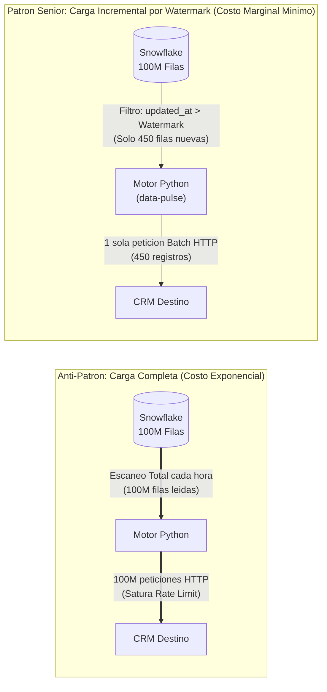

Al imponer en la arquitectura de `data-pulse` el estándar de **Extracción Incremental mediante Marcas de Agua (Watermarks)**, el motor consulta exclusivamente los registros que han sufrido modificaciones desde la última ejecución exitosa (`WHERE updated_at > :last_watermark`). De este modo, el servidor virtual de Snowflake se enciende durante menos de 5 segundos, lee una fracción mínima del disco y se suspende automáticamente, logrando que el costo marginal de extracción tienda a cero.

### C. Criterio Econométrico en la Calidad del Dato
Más allá del ahorro en infraestructura, el entendimiento económico evita errores graves de agregación matemática que los validadores de sintaxis comunes no detectan:
* **Prevención de la Paradoja de Simpson y Promedio de Promedios:** Un ingeniero con base económica jamás calcula el margen de rentabilidad trimestral de una compañía promediando aritméticamente los porcentajes mensuales (`AVG(margin_pct)`), sino operando sobre los numeradores y denominadores agregados ($\sum \text{Beneficio Neto} / \sum \text{Ingresos}$), ponderando correctamente el peso volumétrico de cada cartera o cliente.
* **Diferenciación entre Nominal y Real, Bruto y Neto:** Asegura que los contratos de datos especifiquen de forma inequívoca la divisa (norma ISO-4217), el tratamiento de impuestos, descuentos y devoluciones antes de exponer cualquier indicador al equipo comercial.

---

## 1.4. Habilidades Blandas y el Protocolo de "Semana 0" (Discovery Phase)

El 80% de los fracasos en proyectos de ingeniería de datos no se producen por fallos en la sintaxis de Python o SQL, sino por construir correctamente el sistema equivocado debido a una toma de requerimientos deficiente.

Un Ingeniero de Datos Sénior nunca abre el editor de código el primer día de un proyecto. Ejecuta previamente la **Fase de Descubrimiento (Semana 0)**, sometiendo la iniciativa a un protocolo riguroso de interrogación técnica y de negocio dividido en cuatro dimensiones:

### A. Matriz de Interrogación de "Semana 0"

#### 1. Dimensión de Impacto y Acuerdos de Nivel de Servicio (Para Dirección y Producto)
* **¿Qué acción operativa concreta se disparará cuando este dato llegue al destino?** *(Permite descartar métricas de vanidad que nadie utiliza para tomar decisiones).*
* **¿Cuál es la frecuencia real de toma de decisión humana o algorítmica?** *(Determina si el SLA requiere una ejecución cada 15 minutos, cada hora o diaria a las 07:00 AM).*
* **¿Cuál es el impacto financiero si la sincronización sufre un retraso de 2 horas?** *(Define la criticidad de las alertas de guardia y el presupuesto asignable a redundancia).*

#### 2. Dimensión de Sistemas de Origen y Semántica de Cambios (Para Ingeniería de Backend / Datos)
* **¿Cuál es la volumetría inicial (filas y Gigabytes) y la tasa de cambio diario (*Change Rate*)?** *(Permite dimensionar la memoria RAM de los contenedores y el tamaño de lote o chunk size).*
* **¿Existe una columna de auditoría temporal (`updated_at`) confiable e indexada/agrupada en el origen?** *(Crítico para garantizar cargas incrementales sin escaneos completos).*
* **¿Cómo se gestionan las bajas o eliminaciones en el origen?** *(Determina si existen borrados físicos con `DELETE` o borrados lógicos mediante banderas booleanas como `is_deleted = TRUE`).*

#### 3. Dimensión de Sistemas de Destino y Límites de Red (Crítico para Reverse ETL)
* **¿Cuáles son las cuotas exactas de Rate Limiting de la API receptora?** *(Por ejemplo, HubSpot API v3 impone límites estrictos de peticiones por cada 10 segundos y un tamaño máximo de registros por lote en sus endpoints `/batch/upsert`).*
* **¿Cuál es la clave única de negocio (*Business Key*) para garantizar la idempotencia en el destino?** *(Definir si el emparejamiento se realiza por `email`, por `customer_id` interno o por identificador fiscal).*

#### 4. Dimensión de Seguridad, Privacidad y Tolerancia a Fallos (Para Gobernanza y Operaciones)
* **¿Qué campos contienen Información Personal Identificable (PII) o datos financieros confidenciales?** *(Establece los requisitos de enmascaramiento en Snowflake y firmas HMAC en tránsito).*
* **¿Cuál es el protocolo acordado ante registros individuales corruptos?** *(Se establece formalmente que un registro defectuoso se aislará en una cola de cuarentena o Dead-Letter Queue para inspección posterior, sin detener jamás la sincronización del resto del lote).*

### B. Gestión de Stakeholders: El Arte de Decir "No" mediante Trade-offs Económicos
Cuando un departamento solicita requerimientos técnicamente desproporcionados (por ejemplo: *"Necesitamos recalcular toda la historia de 5 años y sincronizarla con el CRM cada 60 segundos"*), el ingeniero sénior nunca responde con una negativa subjetiva (*"Es muy difícil"*). Expone una **matriz de costos de oportunidad (Trade-offs)** cuantificada en dólares y tiempos:
> *"Ejecutar un recálculo completo cada 60 segundos mantendrá un clúster de Snowflake activo las 24 horas del día y consumirá el 90% de la cuota diaria de la API de vuestro CRM, con un costo de infraestructura estimado en $3,200 USD mensuales. Alternativamente, implementar una arquitectura incremental por marca de agua (`data-pulse`) que sincronice únicamente los registros modificados cada 15 minutos ofrece una frescura de datos idéntica para la operación comercial de los vendedores, con un costo operativo inferior a $15 USD mensuales. ¿Qué arquitectura aprueba la dirección?"*

---

## Glosario de Términos y Conceptos (Módulo 1)

* **Acuerdo de Nivel de Servicio (SLA - Service Level Agreement):** Compromiso formal y medible entre el equipo de ingeniería de datos y el negocio que define la hora máxima de entrega de los datos, su porcentaje de disponibilidad (ej. 99.9%) y el tiempo máximo de respuesta ante incidentes.
* **Aprovisionamiento (Provisioning):** Proceso de configurar y desplegar la infraestructura informática necesaria (servidores, contenedores, bases de datos, redes y permisos de seguridad) para que un sistema de software pueda ejecutarse.
* **Backlog:** Lista priorizada de tareas técnicas, nuevas funcionalidades y correcciones pendientes de desarrollo dentro de un equipo de ingeniería, gestionada mediante metodologías ágiles (Scrum/Kanban).
* **Base de Datos Transaccional (OLTP - Online Transaction Processing):** Sistemas de bases de datos (como PostgreSQL, MySQL u Oracle) diseñados para soportar la operación en vivo de aplicaciones web o móviles, procesando miles de inserciones y lecturas de filas individuales en milisegundos.
* **Borrado Físico (Hard Delete) vs. Borrado Lógico (Soft Delete):** Un *Hard Delete* elimina permanentemente la fila del disco duro mediante la instrucción `DELETE`, sin dejar rastro de cuándo ni qué se borró. Un *Soft Delete* conserva la fila intacta pero actualiza una columna de estado (`is_deleted = TRUE` o `deleted_at = timestamp`), permitiendo que los motores incrementales detecten la baja y la repliquen en los sistemas de destino.
* **CAPEX (Capital Expenditure) vs. OPEX (Operating Expense):** Conceptos financieros fundamentales. *CAPEX* representa la inversión en activos físicos propios a largo plazo (comprar servidores). *OPEX* representa el gasto operativo continuo de alquilar capacidad de cómputo y almacenamiento en la nube pagando estrictamente por los segundos o gigabytes consumidos.
* **Carga Incremental (Incremental Load) vs. Carga Completa (Full Refresh):** La *Carga Completa* procesa y reemplaza la totalidad de los datos históricos en cada ejecución, siendo costosa e ineficiente a gran escala. La *Carga Incremental* filtra y procesa exclusivamente los registros nuevos o modificados desde la última ejecución registrada.
* **Cola de Mensajes Muertos / Cuarentena (DLQ - Dead-Letter Queue):** Tabla o almacén de aislamiento donde un sistema resiliente desvía automáticamente aquellos registros individuales que no pudieron ser validados o entregados tras agotar los reintentos, permitiendo que el resto del lote continúe sin interrupción.
* **DAG (Directed Acyclic Graph / Grafo Acíclico Dirigido):** Estructura matemática utilizada por orquestadores como Apache Airflow para modelar flujos de trabajo. Es "dirigido" porque las tareas siguen una dirección secuencial de dependencias, y "acíclico" porque ninguna tarea puede volver hacia atrás creando un bucle infinito.
* **Data Warehouse (Almacén de Datos Analítico / OLAP):** Base de datos centralizada de alto rendimiento (como Snowflake o Google BigQuery) optimizada para almacenar grandes volúmenes históricos y ejecutar consultas analíticas y agregaciones matemáticas masivas.
* **FinOps (Cloud Financial Operations):** Disciplina de ingeniería y gestión financiera que busca maximizar el valor comercial de cada dólar invertido en la nube mediante la optimización del código, el apagado automático de recursos inactivos y el establecimiento de presupuestos controlados.
* **GDPR / PII (Reglamento General de Protección de Datos / Información Personal Identificable):** Marco legal de privacidad. Se denomina *PII* a cualquier atributo que permita identificar directa o indirectamente a una persona física (nombre, documento de identidad, correo electrónico, teléfono, dirección IP).
* **Headless (Arquitectura Sin Cabeza / Sin Interfaz Gráfica Pesada):** Diseño de software donde el motor lógico funciona en segundo plano gobernado por código, archivos de configuración (YAML) y líneas de comandos (CLI), prescindiendo de interfaces web pesadas y costosas.
* **IAM (Identity and Access Management):** Marco de seguridad en plataformas Cloud que administra las identidades de usuarios y máquinas, definiendo permisos granulares de acceso sobre cada recurso.
* **Idempotencia:** Propiedad matemática y de ingeniería de software según la cual ejecutar una misma operación o tubería de datos una o múltiples veces sobre el mismo conjunto de entrada produce exactamente el mismo estado final en el destino, sin duplicar registros ni alterar totales financieros.
* **Modelo Estrella de Kimball (Star Schema):** Paradigma estándar de modelado dimensional para almacenes de datos. Estructura la información en tablas centrales de *Hechos* (métricas cuantitativas y eventos transaccionales) rodeadas de tablas de *Dimensiones* (atributos descriptivos de clientes, productos o tiempo).
* **Paradoja de Simpson:** Error estadístico que ocurre cuando una tendencia presente en varios grupos de datos por separado se distorsiona o invierte al combinar los grupos sin ponderar adecuadamente sus volúmenes relativos (frecuente al promediar porcentajes directamente en SQL).
* **Rate Limiting (Límite de Tasa de Peticiones):** Mecanismo defensivo de las APIs externas (como HubSpot o Salesforce) que restringe el número máximo de llamadas HTTP permitidas dentro de una ventana de tiempo (ej. 100 peticiones cada 10 segundos). Superar este umbral provoca el rechazo temporal de la conexión mediante el código de estado `HTTP 429 Too Many Requests`.
* **Reverse ETL (Extracción, Transformación y Carga Inversa):** Proceso arquitectónico que extrae datos analíticos ya modelados y enriquecidos desde el Data Warehouse central (Snowflake) y los inyecta hacia las herramientas operativas del negocio (CRMs, plataformas de soporte, sistemas de facturación) para accionar la operación diaria.
* **Stakeholder (Parte Interesada):** Directivo, líder de producto o usuario de negocio que financia, define requerimientos o consume los resultados generados por la infraestructura de datos.
* **Time-to-Value (Tiempo hacia el Valor):** Tiempo transcurrido desde la concepción de un requerimiento de negocio hasta que el dato está disponible en producción generando impacto económico real.
* **Trade-off (Compromiso Arquitectónico / Costo de Oportunidad):** Balance técnico-económico donde la mejora de un atributo del sistema (ej. menor latencia en tiempo real) implica necesariamente un costo en otro atributo (ej. mayor complejidad y mayor gasto mensual en la nube).
* **Watermark (Marca de Agua):** Puntero persistente (habitualmente un valor `timestamp` como `2026-10-28T08:00:00Z` o un identificador secuencial) almacenado tras cada ejecución exitosa para delimitar el punto exacto desde el cual debe comenzar la siguiente lectura incremental.

---
---

# 2. El Flujo de Desarrollo: Del Ecosistema Web a los Sistemas de Datos y Dirección de IA

Para un ingeniero con experiencia en el desarrollo de aplicaciones web (HTML, CSS, JavaScript/TypeScript, React/Vue, APIs REST), la transición hacia la Ingeniería de Datos Sénior no requiere aprender a programar desde cero, sino **reconfigurar el modelo mental sobre cómo se gestionan la memoria RAM, el tiempo de ejecución y el estado de los sistemas**.

## 2.1. Analogía Estructural: Del Desarrollo Web (DOM/HTTP) a los Sistemas de Datos

Tanto una aplicación web Full-Stack como una tubería de datos distribuida resuelven el mismo problema computacional básico: recibir datos de una fuente, aplicarles reglas de validación y transformación, y persistirlos o presentarlos en un destino. La divergencia radica en la **escala volumétrica** y la **naturaleza del disparador (Trigger)**.

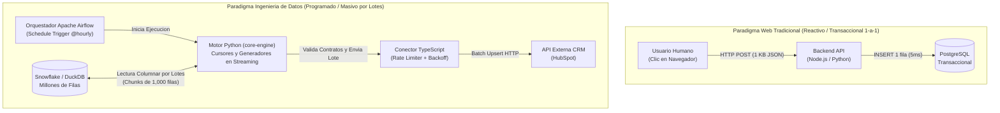

### A. De la Ejecución Reactiva por Usuario al Procesamiento Masivo por Lotes (Batch/Streaming)
1. **En el Desarrollo Web:** El sistema permanece en espera hasta que un usuario humano interactúa con la interfaz gráfica. Cada petición HTTP transporta un objeto JSON diminuto (normalmente entre 1 KB y 50 KB) que representa a un único individuo. El servidor carga ese objeto completo en una variable en memoria RAM, lo procesa en 20 milisegundos y libera la memoria inmediatamente.
2. **En la Ingeniería de Datos:** El disparador no es un clic humano, sino un evento temporal gobernado por un orquestador (**Apache Airflow**) o la llegada de un archivo masivo. El motor de extracción en **Python** se enfrenta a conjuntos de datos que abarcan desde decenas de miles hasta cientos de millones de filas.
   * **El Peligro del Desbordamiento de Memoria (*Out Of Memory - OOM*):** Si un ingeniero aplica la costumbre del desarrollo web e intenta cargar toda la respuesta de la base de datos en una lista en memoria RAM (`rows = cursor.fetchall()` sobre 50 millones de registros), el consumo de memoria superará instantáneamente la capacidad física del contenedor Docker, provocando que el núcleo de Linux (*OOM Killer*) destruya el proceso de forma abrupta.
   * **El Patrón de Flujo Continuo por Fragmentos (*Chunking & Generators*):** En arquitecturas de nivel sénior como `data-pulse`, los datos nunca se cargan en bloque. Se abren cursores de servidor que leen la base de datos en fragmentos controlados (por ejemplo, lotes de 1,000 registros mediante `fetchmany(1000)` y generadores `yield` en Python). De esta forma, el contenedor procesa un lote de 1,000 clientes, lo despacha hacia el conector de salida, limpia la memoria RAM y solicita el siguiente bloque de 1,000, permitiendo sincronizar 100 Gigabytes de información utilizando apenas 150 Megabytes de memoria RAM constante.

### B. Matriz de Equivalencias Mentales (Stack Web vs. Stack de Ingeniería de Datos)

| Componente en Desarrollo Web | Equivalente en Ingeniería de Datos (`data-pulse`) | Función Arquitectónica en el Proyecto |
| :--- | :--- | :--- |
| **Interfaz Gráfica (DOM / HTML / React)** | **Esquema de Destino en el CRM / Tablas Marts de BI** | Es la "cara visible" del trabajo ante los ejecutivos y vendedores. Si el dato llega desalineado o nulo, la interfaz comercial de HubSpot muestra información corrupta al vendedor. |
| **Gestión de Estado (Redux / Pinia / Session)** | **Tabla de Estado de Metadatos y Watermarks** | Almacén persistente que recuerda cuál fue la última marca de tiempo (`updated_at`) sincronizada con éxito y el *hash* de cada registro para no reenviar datos idénticos. |
| **Rutas y Controladores Backend (Express / FastAPI)** | **Manifiestos Declarativos YAML y Motor Python (`core-engine`)** | Define qué datos extraer, coordina los hilos de concurrencia (*Multithreading*), aplica los contratos de entrada (Pydantic) y calcula la telemetría económica FinOps. |
| **Cliente HTTP Frontend (`fetch` / `axios`)** | **Conectores de Salida en TypeScript (`connectors-ts`)** | Valida el esquema exacto exigido por la API de terceros mediante **Zod**, gestiona las firmas criptográficas HMAC y ejecuta las peticiones HTTP respetando el *Rate Limiting*. |
| **Consola del Navegador (`console.log` / Sentry)** | **Observabilidad Estructurada, DLQ y Alertas (Slack/Discord)** | Registro forense en formato JSON de cada lote procesado, aislamiento de registros fallidos en cuarentena y despacho de diagnósticos automáticos al equipo de ingeniería. |

---

## 2.2. El Entorno de Trabajo Real del Senior Data Engineer: Everything as Code

A diferencia de las herramientas corporativas de hace dos décadas —basadas en programas pesados de escritorio donde se arrastraban iconos con el ratón (*Drag-and-Drop* como SSIS o Informatica)—, la Ingeniería de Datos moderna opera bajo el axioma de **Todo como Código (Everything as Code)**.

### A. Por qué la Industria Reemplazó las Interfaces Gráficas Cerradas por Código Puro
1. **Auditabilidad y Control de Versiones en Git:** Un flujo dibujado con el ratón guarda su configuración en archivos binarios o XML propietarios ilegibles para un ser humano. En cambio, cuando las tuberías, las transformaciones SQL y los manifiestos de sincronización están escritos en Python, TypeScript, SQL y YAML, cada modificación queda registrada línea por línea en **Git (`git diff`)**, permitiendo revisiones entre pares (*Code Reviews*) y reversiones instantáneas (*Rollbacks*) en caso de fallo.
2. **Pruebas Automatizadas e Integración Continua (Testing & CI/CD):** Es imposible ejecutar pruebas unitarias en menos de un segundo sobre una interfaz gráfica manual. El código modular permite someter cada función a pruebas de estrés automatizadas antes de tocar los datos reales de la empresa.
3. **Independencia de Infraestructura (Portabilidad en Contenedores):** El código empaquetado en imágenes **Docker** se ejecuta de manera idéntica en un portátil con Windows 10, en un servidor dedicado en Hetzner gestionado con Coolify o en un clúster elástico de Amazon Web Services.

### B. La Tríada Operativa Diaria: IDE Inteligente, Terminal CLI y Contenedores sobre WSL2

En su jornada real, el Ingeniero de Datos Sénior dedica el **85% de su tiempo al entorno de código y terminal** (construcción y pruebas) y el **15% restante a interfaces web de monitoreo** (observación en Apache Airflow Web UI, Snowsight en Snowflake y GitHub).

#### 1. El Entorno de Desarrollo Integrado (Google Antigravity / VS Code)
Actúa como centro de mando unificado. Desde una misma ventana, el ingeniero escribe la lógica de extracción en Python, los conectores tipados en TypeScript, los modelos analíticos en SQL y los manifiestos de infraestructura en Docker Compose. Se apoya en analizadores estáticos en tiempo real (*Ruff* y *Mypy* para Python; *ESLint* y *TypeScript Compiler* para Node.js) que impiden guardar código con errores de tipos o malas prácticas de seguridad.

#### 2. La Interfaz de Línea de Comandos (CLI - Command Line Interface)
El ingeniero sénior opera sus sistemas mediante comandos directos en la terminal de Linux:
* **Docker Compose CLI:** Para orquestar el encendido, reconstrucción e inspección de registros de todos los microservicios locales (`docker compose up -d --build`, `docker compose logs -f core-engine`).
* **Apache Airflow CLI:** Permite probar una tarea aislada de un DAG directamente en la consola (`airflow tasks test ...`) en segundos, sin necesidad de esperar al planificador ni navegar por menús web.
* **CLI Propia del Proyecto (`datapulse` CLI):** Como motor de código abierto de nivel industrial, `data-pulse` expone su propia interfaz de línea de comandos (`datapulse init`, `datapulse validate`, `datapulse run`), permitiendo que cualquier ingeniero en el mundo ejecute sincronizaciones desde su terminal tras clonar el repositorio.

#### 3. Aislamiento en Contenedores Docker sobre Windows Subsystem for Linux (WSL2)
En estaciones de trabajo con sistema operativo Windows 10 o Windows 11, los sistemas de datos de producción **nunca se instalan ni ejecutan directamente sobre el entorno nativo de Windows**, dado que el 99.9% de los servidores en la nube operan sobre distribuciones de **Linux**.
* **Arquitectura sobre WSL2:** Docker Desktop utiliza un núcleo (*Kernel*) real de Linux ejecutándose de forma nativa en Windows mediante **WSL2**.
* **Gestión de Recursos Físicos (`.wslconfig` y Volúmenes de Disco):** Dado que un ecosistema completo de datos (base de datos PostgreSQL de Airflow, Scheduler, Webserver, Motor Python con DuckDB y Servidor TypeScript) requiere memoria RAM y espacio de almacenamiento para las imágenes de los contenedores, el ingeniero sénior audita y configura previamente los límites de hardware del anfitrión: asigna un tope controlado de memoria RAM a la máquina virtual de Linux y ubica los discos virtuales de Docker (`ext4.vhdx`) en unidades de almacenamiento secundarias de alta capacidad (como unidades `D:` o `E:`), montando únicamente la carpeta de código fuente como un volumen espejo (*Bind Mount*) para edición instantánea.

---

## 2.3. Ingeniería de Software Asistida por IA: Dirección Arquitectónica con Google Antigravity

El uso de modelos de lenguaje e Inteligencia Artificial para generar código es hoy una competencia base en la industria. Sin embargo, existe una brecha abismal entre la programación improvisada asistida por IA (*Vibe Coding*) y la **Ingeniería Dirigida por Agentes (Agentic Software Engineering)** practicada por un perfil Senior o Staff.

### A. Los Tres Riesgos Críticos de la Generación de Código sin Supervisión en Datos
1. **Ineficiencia Algorítmica y Costos Ocultos (El Problema $N+1$):** Un modelo de IA al que se le pide genéricamente *"sincroniza estos clientes con la API"* tiende a generar el camino más simple: un bucle `for` que lanza una consulta SQL individual a Snowflake y una petición HTTP individual por cada cliente. Ese código no arroja errores de sintaxis y parece funcionar con 10 registros de prueba, pero al ejecutarse en producción con 100,000 clientes, lanza 100,000 consultas a la nube, agota los créditos financieros y provoca el bloqueo inmediato de la dirección IP por parte del CRM.
2. **Corrupción Silenciosa de Datos (*Silent Failures*):** Sin directrices estrictas, el código generado suele envolver bloques enteros en cláusulas genéricas (`try ... except Exception: pass`) para evitar que el programa falle. En un sistema financiero, ocultar una excepción significa perder miles de registros contables sin dejar rastro en los registros de auditoría.
3. **Acoplamiento Monolítico:** La tendencia por defecto de un generador sin arquitectura es mezclar las credenciales de conexión, las consultas SQL, la lógica de reintentos y las llamadas HTTP dentro de un único archivo imposible de mantener o someter a pruebas unitarias.

### B. Metodología Sénior de Gobierno de Agentes en Google Antigravity (`agy coding`)

En el desarrollo de `data-pulse`, el ingeniero humano actúa como **Arquitecto Principal y Auditor Forense**, mientras que el entorno **Google Antigravity** opera como un equipo de ejecución gobernado mediante cuatro mecanismos estructurales:

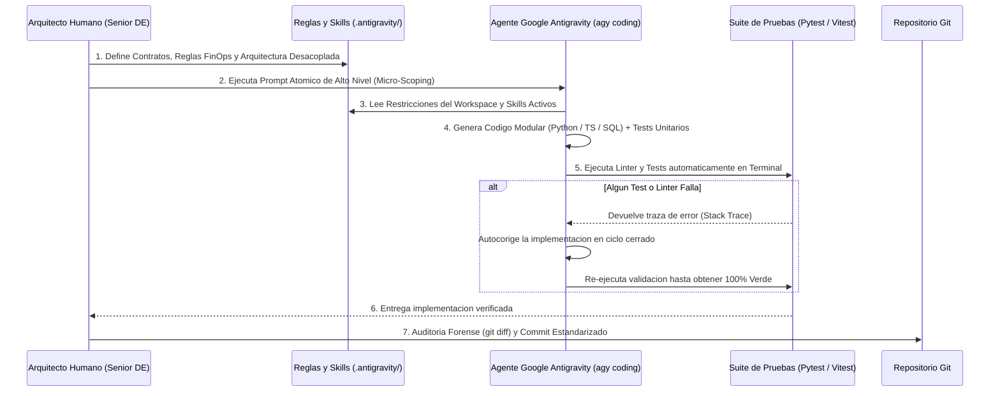

1. **Definición de Agentes y Skills en el Espacio de Trabajo (`.antigravity/`):**
   El repositorio incorpora desde su creación una carpeta de configuración `.antigravity/` que instruye permanentemente al agente del IDE sobre las leyes inquebrantables del proyecto: separación estricta entre `orchestration/`, `core-engine/` y `connectors-ts/`, uso obligatorio de tipado estático (`Pydantic` y `Zod`), prohibición de consultas SQL no acotadas y formatos estándar para la redacción automática de documentación técnica (*ADRs* y *Runbooks*).
2. **Prompts Atómicos y Deterministas (Micro-Scoping):**
   Las órdenes entregadas mediante el comando `agy coding` nunca son ambiguas. Cada prompt especifica exactamente qué archivos crear o modificar, qué patrón de diseño implementar (ej. *Adapter Pattern*, *Token Bucket*), qué firmas de funciones exponer y qué casos borde (*Edge Cases*) cubrir.
3. **Generación Guiada por Pruebas (Test-Driven Agentic Loop):**
   Toda orden de programación exige que el agente escriba simultáneamente el código de producción y su correspondiente suite de pruebas automatizadas (`pytest` en Python, `vitest` en TypeScript), ejecutándolas en la terminal integrada antes de dar por concluida la tarea.
4. **Auditoría Humana de `git diff`:**
   Antes de consolidar cualquier cambio en el historial de Git y subirlo a GitHub (`git push`), el ingeniero verifica que las conexiones a bases de datos utilicen gestores de contexto seguros (`with`), que no existan valores fijos (*hardcoded*) y que la complejidad espacial en memoria sea $O(1)$ respecto al tamaño total de la tabla mediante el uso de lotes (*chunks*).

---

## Glosario de Términos y Conceptos (Módulo 2)

* **Agente de Codificación (AI Coding Agent):** Sistema de inteligencia artificial integrado en el entorno de desarrollo (como Google Antigravity mediante su CLI `agy`) capaz de planificar tareas complejas en múltiples pasos: inspeccionar el árbol de directorios, editar múltiples archivos, ejecutar comandos en la terminal, analizar errores de compilación y corregir su propio código de forma autónoma.
* **Análisis Estático de Código (Static Code Analysis / Linting):** Proceso automatizado (ejecutado por herramientas como *Ruff*, *Mypy* o *ESLint*) que examina el código fuente sin necesidad de ejecutarlo para detectar errores de tipado, variables no utilizadas, vulnerabilidades de seguridad o incumplimientos de las normas de estilo de ingeniería.
* **Bind Mount / Volume Mount (Montaje de Volumen en Docker):** Mecanismo que conecta en tiempo real una carpeta física del sistema operativo anfitrión (Windows) con un directorio interno del contenedor virtual (Linux), permitiendo que cualquier cambio guardado en el editor de código se refleje instantáneamente dentro del contenedor sin reconstruir la imagen.
* **Chunking / Batching (Fragmentación por Lotes):** Técnica esencial de gestión de memoria que divide la lectura y el procesamiento de un conjunto masivo de datos en bloques pequeños de tamaño fijo (ej. 1,000 filas por lote), garantizando que el consumo de memoria RAM se mantenga plano y predecible sin importar si la tabla original tiene diez mil o cien millones de registros.
* **Complejidad Espacial $O(1)$ (Memoria Constante):** En notación algorítmica *Big-O*, significa que la cantidad de memoria RAM que consume un programa no crece aunque aumente el tamaño de los datos de entrada. Se logra procesando los datos como un flujo continuo (*stream*) lote por lote en lugar de acumularlos todos en una variable.
* **Contrato de Datos (Data Contract):** Especificación técnica programada en el código (mediante librerías como *Pydantic* en Python o *Zod* en TypeScript) que actúa como aduana de validación: define de forma obligatoria los nombres de campos, tipos de datos y restricciones matemáticas que debe cumplir un registro antes de ser procesado o enviado a una API externa.
* **Cursor de Base de Datos y Generadores (`yield`):** Un cursor es una estructura de control que mantiene una referencia sobre los resultados de una consulta SQL en el servidor, permitiendo extraer filas gradualmente bajo demanda. Combinado con funciones generadoras en Python (que utilizan la instrucción `yield` en lugar de `return`), permite recorrer millones de registros en flujo continuo sin saturar la memoria local.
* **Git Diff:** Herramienta de inspección del sistema de control de versiones Git que muestra con precisión quirúrgica las líneas exactas añadidas, modificadas o eliminadas en el código fuente antes de confirmar un cambio (*commit*).
* **Gestor de Contexto (Context Manager - Cláusula `with`):** Construcción del lenguaje Python que garantiza la liberación segura y automática de recursos críticos (como cerrar conexiones abiertas a Snowflake o descriptores de archivos) inmediatamente después de finalizar un bloque de código, incluso si ocurre un error fatal durante su ejecución.
* **Multithreading (Ejecución Multihilo):** Técnica de concurrencia donde un mismo proceso informático abre múltiples hilos de ejecución paralelos que comparten memoria. Resulta óptima para acelerar operaciones limitadas por tiempos de espera de red (*I/O-Bound*), como realizar peticiones simultáneas a APIs o bases de datos.
* **Out Of Memory (OOM - Agotamiento de Memoria):** Fallo crítico del sistema que se produce cuando un proceso intenta asignar más memoria RAM de la permitida por el hardware físico o el límite del contenedor Docker, provocando la terminación forzosa e inmediata del programa por parte del sistema operativo (*OOM Killer*).
* **Payload (Carga Útil de Datos):** Cuerpo de datos estructurados (generalmente en formato JSON) que viaja dentro de una petición o respuesta HTTP hacia una API o Webhook, excluyendo las cabeceras técnicas de transporte y autenticación.
* **Problema de Consultas $N+1$ ($N+1$ Query Anti-Pattern):** Grave error de rendimiento que ocurre cuando un programa ejecuta 1 consulta inicial para obtener una lista de $N$ elementos y, a continuación, ejecuta dentro de un bucle $N$ consultas individuales adicionales a la base de datos o a una API (una por cada fila), en lugar de agrupar la operación en una sola llamada por lotes (*Batch*).
* **Skill de Agente (Agent Skill):** Módulo de conocimiento e instrucciones operativas reutilizables almacenado dentro del repositorio (en `.antigravity/`) que enseña al agente de IA cómo ejecutar tareas especializadas siguiendo los estándares exactos del equipo (ej. cómo auditar una consulta SQL bajo reglas FinOps o cómo estructurar un test de resiliencia).
* **WSL2 (Windows Subsystem for Linux 2):** Capa de virtualización ligera de alto rendimiento integrada en Windows que ejecuta un núcleo (*Kernel*) real de Linux, permitiendo que los contenedores de Docker operen en Windows con el mismo comportamiento y velocidad que en un servidor Linux nativo.

---
---

# 3. Inmersión en Snowflake, Simulación Local con DuckDB y Transformación con dbt

El corazón de la arquitectura analítica moderna reside en la combinación de un almacén de datos columnar elástico en la nube (**Snowflake**), un motor analítico local equivalente para desarrollo y ejecución libre sin dependencias externas (**DuckDB**) y un marco de transformación declarativa gobernado por control de versiones (**dbt**).

## 3.1. Desmitificando Snowflake: Arquitectura Interna de Tres Capas y Operación Real

**Snowflake** no es una base de datos tradicional empaquetada como un software descargable, sino una plataforma analítica nativa de la nube entregada bajo el modelo **SaaS (Software as a Service)** que opera sobre la infraestructura física de Amazon Web Services (AWS), Google Cloud Platform (GCP) o Microsoft Azure.

### A. La Separación Física de Almacenamiento, Cómputo y Servicios
En los sistemas de bases de datos clásicos (como PostgreSQL, Oracle o almacenes locales antiguos), los discos duros donde residen los datos y los procesadores (CPU/RAM) que ejecutan las consultas están acoplados dentro del mismo servidor físico. Si múltiples procesos lanzan consultas simultáneas, compiten por la misma memoria RAM y bloquean el sistema.

Snowflake resuelve esta limitación mediante una **arquitectura desacoplada de tres capas independientes**:

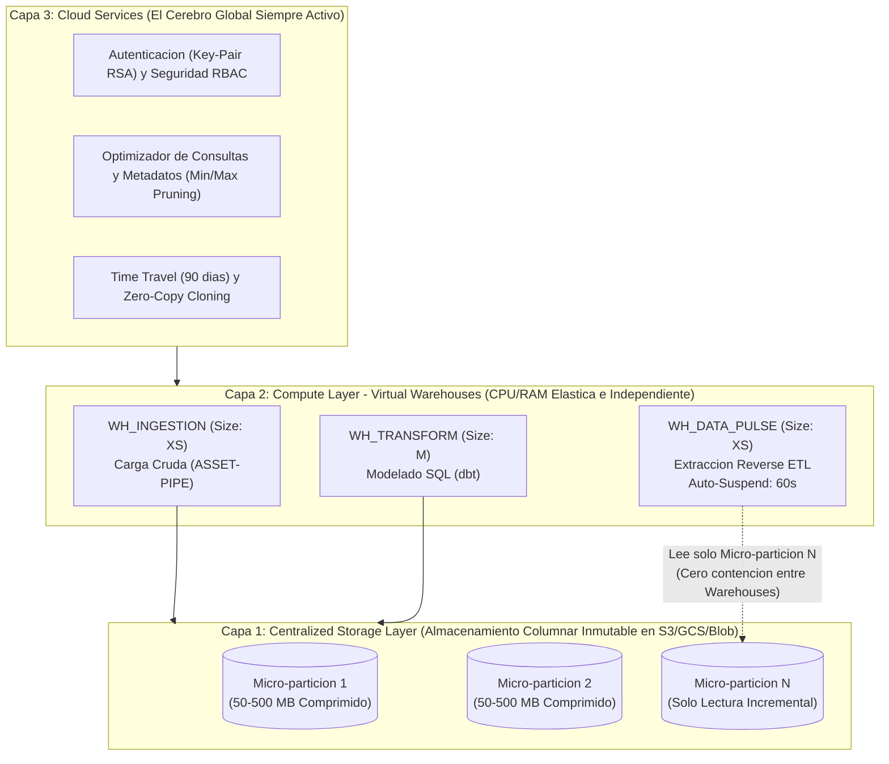

#### 1. Capa de Almacenamiento Centralizado (Storage Layer)
Al ingresar datos en Snowflake, la plataforma los reorganiza automáticamente en un formato **columnar propietario, comprimido y encriptado (AES-256)**, dividiéndolos en archivos físicos inmutables denominados **Micro-particiones** (cuyo tamaño oscila entre 50 MB y 500 MB de datos sin comprimir, equivalentes a unos 16 MB comprimidos en disco). Estos archivos residen en el almacenamiento de objetos de bajo costo de la nube (ej. Amazon S3). La empresa paga una tarifa plana mensual por Terabyte almacenado (~$23–$40 USD/TB/mes), independientemente de la potencia de cálculo utilizada.

#### 2. Capa de Procesamiento Elástico (Compute Layer — "Virtual Warehouses")
En la terminología estricta de Snowflake, un **Virtual Warehouse (Almacén Virtual)** no almacena ni un solo byte de datos permanentes: es exclusivamente **un clúster de servidores de cómputo (CPU, memoria RAM y caché local SSD)** que se enciende para ejecutar consultas SQL.
* **Escalado por Tallas (T-Shirt Sizing):** Se dimensionan en potencias de dos, desde **X-Small** (1 nodo / 1 crédito por hora), **Small** (2 nodos / 2 créditos por hora), **Medium** (4 nodos / 4 créditos por hora) hasta **6X-Large** (512 nodos / 512 créditos por hora).
* **Aislamiento de Cargas de Trabajo (Workload Isolation):** El equipo de ingeniería asigna un *Virtual Warehouse* exclusivo de talla `X-Small` para el motor `data-pulse` (`WH_DATA_PULSE_XS`), mientras el equipo de Ciencia de Datos utiliza otro independiente (`WH_ML_LARGE`). Ambos leen simultáneamente las mismas micro-particiones de la capa de almacenamiento sin competir por memoria RAM ni degradar el rendimiento del otro.
* **Control FinOps de Auto-Suspend y Auto-Resume:** Un *Virtual Warehouse* configurado con `AUTO_SUSPEND = 60` y `AUTO_RESUME = TRUE` permanece apagado (costo $0.00 USD) mientras no hay actividad. Cuando Apache Airflow dispara la extracción de `data-pulse`, el clúster despierta en menos de un segundo, ejecuta la lectura incremental en 4 segundos y, tras 60 segundos sin recibir nuevas consultas, se apaga automáticamente.

#### 3. Capa de Servicios en la Nube (Cloud Services Layer)
Coordina globalmente la plataforma sin intervención manual: gestiona la seguridad basada en roles (**RBAC**), compila y optimiza el plan de ejecución de las consultas SQL utilizando los metadatos de las micro-particiones, controla las transacciones ACID y habilita dos capacidades diferenciales para la ingeniería de datos:
* **Time Travel (Viaje en el Tiempo):** Como las micro-particiones son inmutables (cuando se actualiza o borra una fila, Snowflake no destruye el archivo original, sino que escribe una micro-partición nueva y conserva un puntero a la antigua hasta por 90 días), un ingeniero puede consultar o restaurar instantáneamente el estado exacto de una tabla antes de un error humano mediante `SELECT * FROM tabla AT(OFFSET => -60*5)` (hace 5 minutos).
* **Zero-Copy Cloning (Clonación Instantánea sin Copia Física):** Permite ejecutar `CREATE DATABASE analytics_staging CLONE analytics_prod;` y obtener en 3 segundos una copia funcional completa de una base de datos de 20 Terabytes para hacer pruebas reales en CI/CD sin duplicar archivos en el disco y con **$0.00 USD de costo adicional de almacenamiento**.

### B. Los Tres Canales de Interacción Profesional con Snowflake
1. **Snowsight (Interfaz Web de Observabilidad y Administración):** Portal web oficial utilizado para auditar el consumo financiero de créditos, administrar monitores de recursos (*Resource Monitors*) y diagnosticar consultas complejas mediante el **Query Profile** (árbol visual de operadores físicos).
2. **Snowflake CLI (`snow`) y Extensiones de IDE:** Herramientas de línea de comandos e integración directa con Google Antigravity / VS Code para ejecutar scripts de aprovisionamiento de infraestructura SQL versionados en Git.
3. **Conectores Programáticos (`snowflake-connector-python`):** Canal empleado en producción por `data-pulse`. El contenedor de Python se autentica de forma desatendida mediante criptografía de llave pública/privada (**RSA Key-Pair**) y extrae lotes incrementales a través de cursores optimizados.

---

## 3.2. El Dilema Offline vs. Online: Arquitectura Dual con DuckDB para Ejecución Universal

Dado que Snowflake es una plataforma exclusivamente en la nube, plantea dos desafíos críticos tanto para el desarrollo diario de un ingeniero como para la adopción de un proyecto **Open Source** como `data-pulse`:
1. **En el Desarrollo e Integración Continua Empresarial:** Ejecutar miles de pruebas automatizadas conectándose por internet a Snowflake en cada cambio de código ralentiza el desarrollo y consume créditos financieros innecesarios.
2. **En la Comunidad Open Source:** Si un reclutador técnico, un arquitecto o un desarrollador externo clona el repositorio de `data-pulse` desde GitHub (`git clone`) y se le exige poseer una cuenta corporativa activa de Snowflake para poder ver funcionar el motor, la barrera de entrada impide su evaluación inmediata.

### La Solución Arquitectónica: Patrón Adaptador (Adapter Pattern) con Motor Analítico Local DuckDB

Para lograr que `data-pulse` sea simultáneamente un sistema listo para Snowflake en producción empresarial y un proyecto **100% ejecutable en 60 segundos sin cuenta de Snowflake ni conexión a la nube**, implementamos una capa de abstracción basada en el **Patrón de Diseño Adaptador** combinada con **DuckDB**.

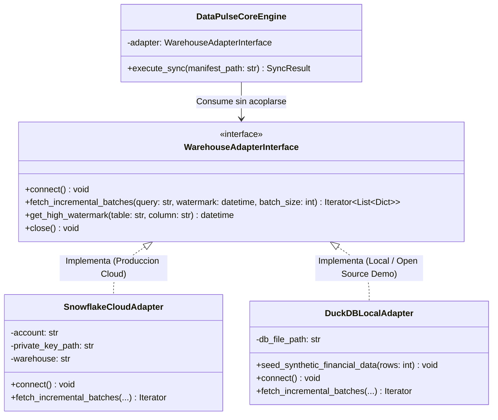

#### ¿Por qué DuckDB es el Sustituto Local Perfecto de Snowflake?
A diferencia de SQLite o PostgreSQL (que son bases de datos orientadas a filas), **DuckDB** es un motor de base de datos analítico (OLAP), **columnar**, vectorizado y de código abierto que se ejecuta directamente dentro del proceso de Python (*In-Process*) guardando los datos en un único archivo local (`local_warehouse.duckdb`) sin requerir servidores externos.
* **Compatibilidad SQL Analítica:** Soporta funciones avanzadas idénticas a Snowflake (cláusula `QUALIFY`, funciones de ventana, lectura directa de archivos Apache Parquet).
* **Generación Determinista de Datos Sintéticos (*Auto-Seeding*):** Cuando un usuario clona `data-pulse` y ejecuta el entorno con la variable por defecto `SOURCE_ENGINE=duckdb_local`, el motor inicializa automáticamente la base de datos DuckDB e inyecta un conjunto determinista de **10,000 clientes corporativos** con métricas financieras de ingresos, costos, rentabilidad neta y marcas de tiempo `updated_at`, incluyendo deliberadamente un **2% de registros con anomalías estructurales** (correos mal formados, divisiones por cero `NaN`) para demostrar en vivo el funcionamiento de la cola de cuarentena (DLQ) y el diagnóstico asistido.
* **Transición Transparente a la Nube:** Cuando la empresa desea pasar a producción real con Snowflake, no modifica ni una sola línea de código en Python o TypeScript; únicamente cambia la variable de entorno a `SOURCE_ENGINE=snowflake` y provee sus credenciales en el archivo `.env`.

---

## 3.3. El Estándar de Oro en Transformación: dbt (Data Build Tool) en Desarrollo y Producción

Antes de que un motor de Reverse ETL como `data-pulse` pueda extraer indicadores de rentabilidad listos para enviar al CRM, esos indicadores deben haber sido limpiados, cruzados y calculados dentro del Data Warehouse. Esta fase intermedia constituye la **"T" (Transform)** del paradigma moderno **ELT (Extract, Load, Transform)** y está dominada globalmente por **dbt (Data Build Tool)**.

### A. Arquitectura Medallón (Bronze $\rightarrow$ Silver $\rightarrow$ Gold) y el Lugar de `data-pulse`
En una plataforma de datos bien estructurada, la información fluye a través de tres capas progresivas de refinamiento dentro de Snowflake o DuckDB:

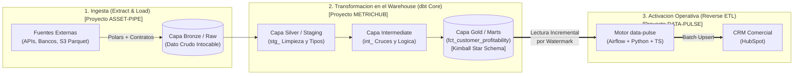

1. **Capa Bronze / Raw (Dato Crudo):** Tablas donde los procesos de ingesta depositan la información exactamente como llegó de los sistemas de origen. Nadie modifica ni consulta directamente esta capa para reportes.
2. **Capa Silver / Staging e Intermediate (`stg_`, `int_`):** Modelos de dbt que estandarizan nombres de columnas, convierten formatos de fecha a UTC, eliminan duplicados técnicos y aplican reglas de negocio intermedias.
3. **Capa Gold / Marts (`fct_`, `dim_`):** Tablas finales estructuradas bajo la **Metodología Dimensional de Kimball (Esquema en Estrella)**. Aquí residen las tablas certificadas como `fct_customer_profitability` o los puntajes econométricos generados por motores de inferencia causal (`CAUSAL-ML`). **Regla de Arquitectura:** Un motor de Reverse ETL como `data-pulse` jamás se conecta a las capas crudas (`Raw` o `Staging`); consume exclusivamente tablas o vistas gobernadas de la capa **`Marts`**.

### B. Mecánica Interna de dbt: Compilación Jinja-SQL, Linaje y Entornos (`dev` vs. `prod`)
**dbt** no extrae los datos hacia fuera de Snowflake para calcularlos; actúa como un compilador que traduce archivos `.sql` enriquecidos con plantillas **Jinja** en instrucciones DDL/DML (`CREATE TABLE AS SELECT`, `MERGE INTO`) que se ejecutan usando los procesadores internos de Snowflake.

1. **Referencias Dinámicas y Grafo de Linaje (`{{ ref() }}`):** En lugar de escribir nombres fijos de esquemas, un ingeniero escribe `SELECT * FROM {{ ref('stg_invoices') }}`. Esto permite a dbt construir automáticamente el árbol de dependencias (linaje de datos) y desplegar exactamente el mismo código en distintos entornos sin editar los archivos SQL.
2. **Aislamiento entre Desarrollo (`target: dev`) y Producción (`target: prod`):**
   * Mientras el ingeniero programa en su IDE local, ejecuta `dbt run --target dev`. dbt compila las tablas dentro de un esquema privado de prueba en Snowflake (ej. `DBT_DEV_SCHEMA`), impidiendo que sus experimentos afecten a los datos reales de la compañía.
   * Cuando el código supera las revisiones en GitHub, el orquestador Apache Airflow ejecuta en producción `dbt build --target prod`, el cual actualiza las tablas oficiales en el esquema `ANALYTICS_PROD`, ejecuta las pruebas de integridad (`dbt test` verificando que no existan llaves primarias duplicadas ni valores nulos) y, solo tras confirmar el éxito total, autoriza el inicio del DAG de `data-pulse`.

---

## Glosario de Términos y Conceptos (Módulo 3)

* **Almacenamiento Columnar (Columnar Storage):** Diseño físico de bases de datos analíticas (Snowflake, DuckDB, BigQuery, archivos Parquet) donde los valores de cada columna se guardan contiguos en el disco duro en lugar de guardar filas completas juntas. Permite leer y sumar millones de valores de una sola columna financiera en milisegundos ignorando las demás columnas de la tabla.
* **Arquitectura Medallón (Medallion Architecture):** Patrón de organización lógica de datos en tres niveles de calidad creciente: **Bronze / Raw** (datos crudos originales), **Silver / Staging-Intermediate** (datos filtrados, limpios y conformados) y **Gold / Marts** (datos agregados y modelados para el consumo de negocio y Reverse ETL).
* **Auto-Seeding (Sembrado Automático de Datos Sintéticos):** Proceso automatizado mediante el cual un sistema genera e inserta datos de prueba matemáticamente realistas al arrancar por primera vez en un entorno local, permitiendo evaluar y demostrar todas las capacidades del software sin requerir datos privados reales.
* **Auto-Suspend / Auto-Resume:** Mecanismos de eficiencia energética y financiera en Snowflake que apagan automáticamente el clúster de servidores (*Virtual Warehouse*) tras un periodo configurable de inactividad (ej. 60 segundos) y lo vuelven a encender instantáneamente al recibir una nueva petición SQL.
* **Crédito de Snowflake (Snowflake Credit):** Unidad de tarificación del consumo de cómputo en Snowflake. El costo consumido depende de la talla del *Virtual Warehouse* (desde 1 crédito/hora en talla *X-Small*) multiplicado por el tiempo exacto en segundos que el servidor permanece encendido.
* **DDL / DML (Data Definition Language / Data Manipulation Language):** Subconjuntos del lenguaje SQL. *DDL* agrupa los comandos que definen estructuras (`CREATE TABLE`, `ALTER`, `DROP`), mientras que *DML* agrupa los comandos que manipulan las filas de datos (`SELECT`, `INSERT`, `UPDATE`, `MERGE`).
* **DuckDB:** Motor de gestión de bases de datos analítico (OLAP), columnar, de código abierto y embebido (*In-Process*). Permite ejecutar consultas SQL analíticas de alta velocidad sobre archivos locales sin necesidad de instalar ni administrar un servidor externo.
* **ELT (Extract, Load, Transform):** Paradigma moderno de ingeniería de datos donde los datos crudos se extraen de las fuentes (**E**), se cargan directamente en el almacén analítico (**L**) y se transforman dentro del propio almacén aprovechando su potencia masiva de cálculo (**T**) mediante herramientas como dbt.
* **In-Process Database (Base de Datos En-Proceso):** Base de datos que se ejecuta como una librería dentro del mismo espacio de memoria de la aplicación que la invoca (como DuckDB dentro de Python), eliminando la latencia de red entre el programa y los datos.
* **Jinja:** Motor de plantillas en Python utilizado por dbt para dotar al lenguaje SQL de capacidades de programación modular, tales como variables dinámicas, condicionales (`if/else`), bucles (`for`) y macros reutilizables.
* **Linaje de Datos (Data Lineage):** Trazabilidad completa del recorrido de un dato desde su tabla de origen hasta su destino final en un CRM o reporte, permitiendo visualizar qué procesos dependen de qué tablas.
* **Micro-partición (Micro-partition):** Unidad física elemental e inmutable de almacenamiento en Snowflake (de 50 MB a 500 MB de datos sin comprimir). Almacena los datos de forma columnar junto con metadatos estadísticos automáticos (valores mínimos, máximos y conteo de nulos por columna).
* **Patrón Adaptador (Adapter Design Pattern):** Patrón estructural de ingeniería de software que define una interfaz común en el código, permitiendo conectar e intercambiar diferentes motores de bases de datos (como Snowflake en producción y DuckDB en local) sin alterar la lógica central del sistema.
* **Query Profile (Perfil de Ejecución de Consulta):** Herramienta visual de diagnóstico en la interfaz web de Snowflake (*Snowsight*) que representa el grafo de operadores físicos de una consulta SQL, detallando el tiempo invertido y los volúmenes de datos procesados en cada etapa.
* **Time Travel (Viaje en el Tiempo):** Capacidad nativa de Snowflake (y formatos modernos como Apache Iceberg) que permite consultar, clonar o restaurar tablas al estado exacto en que se encontraban en un instante específico del pasado sin necesidad de recurrir a copias de seguridad en cinta.
* **Virtual Warehouse (Almacén Virtual de Cómputo):** En Snowflake, clúster independiente de recursos de procesamiento (CPU, RAM y disco SSD temporal) encargado exclusivamente de ejecutar consultas SQL, completamente separado de la capa donde se almacenan los datos.
* **Zero-Copy Cloning (Clonación sin Copia Física):** Tecnología de Snowflake que crea una copia lógica instantánea de una tabla o base de datos apuntando a las mismas micro-particiones físicas originales, permitiendo generar entornos de prueba idénticos a producción en segundos y sin costo adicional de almacenamiento.

---
---

# 4. Arquitectura en Acción: Orquestación en Airflow, Resiliencia y Diagnóstico Asistido (`data-pulse`)

La construcción de un sistema de activación operativa de datos (Reverse ETL) de grado industrial exige resolver un problema fundamental de sistemas distribuidos: acoplar un almacén analítico masivo y ultrarrápido (**Snowflake / DuckDB**) con APIs comerciales externas (**HubSpot CRM API v3 / Webhooks**) que son inherentemente lentas, propensas a microcortes de red y gobernadas por estrictas cuotas de velocidad (*Rate Limits*).

El motor **`data-pulse`** resuelve esta asimetría mediante una arquitectura declarativa desacoplada en tres anillos: **Orquestación en Apache Airflow**, **Núcleo de Extracción e Inteligencia Operativa en Python (`core-engine`)** y **Conectores de Validación y Despacho en TypeScript (`connectors-ts`)**.

## 4.1. Orquestación Profesional con Apache Airflow y Manifiestos Declarativos YAML

En entornos de producción, ejecutar scripts mediante tareas básicas del sistema operativo (`cron`) carece de gestión de dependencias, reintentos inteligentes, trazabilidad histórica y recuperación ante fallos. **Apache Airflow** actúa como el plano de control programático del ecosistema.

### A. Topología Interna de Apache Airflow en Contenedores Docker
Cuando el entorno de `data-pulse` se despliega mediante `docker-compose`, Apache Airflow opera como un sistema distribuido compuesto por cuatro servicios cooperativos:
1. **Scheduler (Planificador):** Proceso demonio continuo que inspecciona el directorio de flujos (`orchestration/dags/`), evalúa los intervalos temporales programados y despacha las tareas listas para ejecutarse.
2. **Executor y Workers (Ejecutores):** Procesos encargados de ejecutar físicamente las órdenes de extracción y sincronización sin bloquear el hilo principal del planificador.
3. **Metadata Database (Base de Datos de Estado en PostgreSQL):** Almacena el registro histórico de ejecuciones, tiempos de duración, estados de tareas (*Success, Failed, Up for Retry*) y marcas de auditoría.
4. **Webserver (Interfaz de Monitoreo y Control):** Provee el panel visual en el puerto `8080` donde los ingenieros y operadores auditan los grafos de ejecución, inspeccionan registros de consola (*logs*) y ejecutan reprocesamientos.

### B. El Patrón "Thin DAGs" (DAGs Delgados) y Sincronización Declarativa como Código
Un antipatrón grave en Ingeniería de Datos consiste en incrustar consultas SQL, lógica de transformación y clientes HTTP directamente dentro del archivo Python del DAG en la carpeta `/dags`. Dado que el *Scheduler* de Airflow analiza sintácticamente (*parsea*) todos los archivos de esa carpeta cada 30 segundos, incluir código pesado o conexiones de red en el nivel superior del archivo degrada severamente la CPU del servidor.

En `data-pulse` aplicamos dos principios de diseño de nivel Staff:
1. **Orquestación Desacoplada (Thin DAGs):** El archivo del DAG en Airflow contiene exclusivamente la topología de dependencias, la política de reintentos de infraestructura y las llamadas al motor externo a través de su interfaz de línea de comandos (`datapulse run --sync <manifest>`).
2. **Manifiestos Declarativos de Sincronización (`syncs/*.yml`):** En lugar de programar un script nuevo por cada tabla que la empresa desee enviar a un CRM (convirtiendo a `data-pulse` en una alternativa abierta y ligera frente a plataformas cerradas como Hightouch), toda sincronización se define en un archivo YAML versionado en Git:

```yaml
version: "1.0"
sync_id: "hubspot_customer_profitability"
description: "Sincronizacion incremental de indicadores de rentabilidad neta hacia HubSpot CRM"
schedule: "0 * * * *" # Ejecucion horaria

source:
  engine_env: "SOURCE_ENGINE" # Alterna entre 'snowflake' y 'duckdb_local'
  target_table: "analytics_prod.marts.fct_customer_profitability"
  watermark_column: "updated_at"
  lookback_window_minutes: 15
  primary_key: "customer_id"
  batch_size: 1000

ai_enrichment:
  enabled: true
  executive_brief_threshold_margin_drop_pct: -10.0 # Solo genera resumen en cuentas VIP con caida critica
  dlq_auto_triage: true

destination:
  connector: "hubspot_crm_v3"
  object_type: "contacts"
  operation: "batch_upsert"
  idempotency_match_key: "email"
  rate_limit:
    max_requests: 100
    per_seconds: 10
  field_mapping:
    customer_id: "hs_external_customer_id"
    email: "email"
    net_profitability_usd: "hs_net_profitability_usd"
    profit_margin_pct: "hs_profit_margin_pct"
    customer_tier: "hs_financial_health_tier"
    ai_executive_brief: "hs_sales_action_notes"
```

### C. Idempotencia Temporal, Lookback Windows y Backfilling
Para garantizar que el sistema pueda reprocesar cualquier periodo sin pérdida ni duplicación de registros, `data-pulse` implementa tres salvaguardas matemáticas:
1. **Prohibición de Relojes Relativos (`datetime.now()`):** Las consultas incrementales nunca dependen de la hora de ejecución física del servidor, sino del puntero persistido en la tabla de estado (*High Watermark*) o de los límites lógicos del intervalo de Airflow (`data_interval_start` y `data_interval_end`).
2. **Ventana de Solapamiento contra Datos Tardíos (*Lookback Window*):** En sistemas distribuidos, una transacción en origen puede iniciarse a las `07:59:55` pero confirmarse en disco a las `08:00:05`. Si el corte incremental se hiciera estrictamente en `08:00:00`, dicho registro quedaría excluido permanentemente (*Late-Arriving Data*). El motor aplica una ventana de retroceso configurable ($\Delta t = 15\text{ minutos}$):
   $$\text{Filtro Incremental: } \quad \text{updated\_at} \ge (\text{Watermark}_{\text{anterior}} - \Delta t)$$
3. **Deduplicación por Hash de Contenido (*Payload Hash Diffing*):** Antes de despachar un registro capturado en la ventana de solapamiento hacia el conector de TypeScript, el motor calcula una huella digital `SHA-256` de los valores del registro y la compara con el último *hash* enviado con éxito a HubSpot. Si el contenido no ha variado, el envío se omite en memoria RAM, ahorrando hasta un 80% de tráfico HTTP innecesario.

---

## 4.2. Ingeniería de Resiliencia: Control de Flujo en Python, Conectores en TypeScript e Inteligencia Operativa

Cuando los lotes de datos abandonan el almacén analítico y se dirigen hacia las APIs externas, el sistema debe gestionar límites de tasa, errores transitorios de red, anomalías en los datos y generación de contexto ejecutivo.

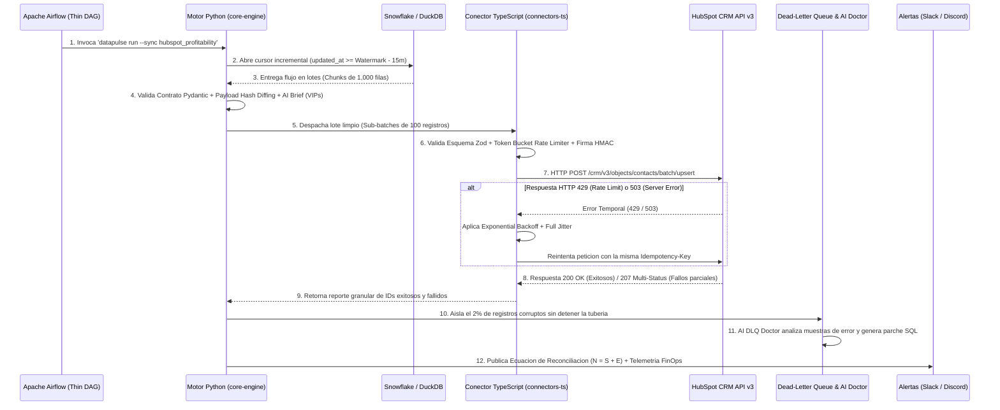

### A. Control Estricto de Rate Limiting con Token Bucket, Exponential Backoff y Full Jitter
Las APIs de CRMs corporativos protegen su infraestructura aplicando límites estrictos (por ejemplo, HubSpot permite 100 peticiones cada 10 segundos). Superar este umbral provoca respuestas **`HTTP 429 Too Many Requests`**. Nuestro motor implementa una defensa en dos niveles:

#### 1. Prevención Activa: Algoritmo Token Bucket (Cubo de Fichas)
Antes de emitir una llamada HTTP, los hilos concurrentes de trabajo deben adquirir un permiso de un limitador en memoria basado en el algoritmo *Token Bucket*. Si la cuota es de 10 peticiones por segundo, el depósito regenera exactamente 10 fichas por segundo; si 15 hilos intentan transmitir simultáneamente, 10 proceden de inmediato y 5 aguardan milisegundos en cola local, impidiendo saturar la red de forma preventiva.

#### 2. Mitigación Reactiva: Exponential Backoff con Full Jitter
Ante respuestas de error transitorio (`HTTP 429`, `502 Bad Gateway`, `503 Service Unavailable` o `504 Gateway Timeout`), un reintento inmediato o con espera fija provoca el **Problema de la Manada en Estampida (*Thundering Herd*)**: todos los hilos concurrentes vuelven a golpear el servidor caído exactamente en el mismo milisegundo, agravando el bloqueo.

Para desincronizar matemáticamente los hilos y permitir la recuperación de la API externa, implementamos **Retroceso Exponencial con Ruido Aleatorio Completo (*Full Jitter*)**. El tiempo de espera $T_{\text{sleep}}$ antes del intento número $n$ ($n \in \{0, 1, 2, \dots, N_{\max}\}$) se define mediante la distribución uniforme continua:

$$T_{\text{sleep}}(n) = \mathcal{U}\left(0, \, \min\left(T_{\max}, \, T_{\text{base}} \cdot 2^n\right)\right)$$

Donde $T_{\text{base}}$ es el tiempo inicial de espera (ej. $1.0\text{ segundo}$) y $T_{\max}$ es el techo máximo de espera (ej. $60.0\text{ segundos}$). 
* **Distinción Semántica de Códigos HTTP:** Los errores de cliente permanentes (`HTTP 400 Bad Request`, `401 Unauthorized`, `422 Unprocessable Entity`) jamás se someten a reintentos, ya que repetir una petición con datos inválidos solo desperdicia recursos; son desviados inmediatamente a la cola de cuarentena.

### B. Concurrencia en Python y Validación de Contratos en TypeScript
1. **Concurrencia Limitada por Entrada/Salida (*I/O-Bound Multithreading*):** Dado que el 95% del tiempo de ejecución de un Reverse ETL transcurre esperando respuestas de red de Snowflake y del CRM, Python libera el cerrojo global del intérprete (*GIL*) en cada operación de red. El uso de un grupo controlado de hilos (`ThreadPoolExecutor`) combinado con llamadas por lotes (*Batch Endpoints* de 100 registros por petición HTTP) permite sincronizar decenas de miles de registros en segundos manteniendo el consumo de RAM por debajo de 150 MB.
2. **Aduana de Salida en TypeScript con Zod:** El servicio conector en TypeScript recibe los lotes y aplica una validación de esquemas en tiempo de ejecución mediante **Zod**. Verifica que ningún valor numérico sea `NaN` o `Infinity` (valores ilegales en la especificación RFC 8259 de JSON), valida el formato de correos electrónicos e inyecta en las cabeceras HTTP una clave determinista de idempotencia (`Idempotency-Key`) junto con la firma criptográfica `HMAC-SHA256`.

### C. Aislamiento Granular en Cuarentena (DLQ) y Diagnóstico Asistido por IA
Cumpliendo el estándar de resiliencia sénior, **un registro defectuoso nunca detiene el lote**. Si de un bloque de 10,000 clientes extraídos, 9,800 son válidos y 200 (el 2%) contienen errores estructurales, los 9,800 se actualizan puntualmente en HubSpot y los 200 se registran en la tabla de **Cola de Cuarentena (*Dead-Letter Queue - DLQ*)** con su identificador, causa exacta de rechazo y carga útil original.

Sobre esta arquitectura se integran dos módulos de Inteligencia Operativa gobernados bajo principios FinOps (con soporte para modelos generativos vía API como Gemini/OpenAI y un motor heurístico determinista local de respaldo para ejecuciones sin clave externa):
1. **AI DLQ Doctor (Triaje y Diagnóstico Automatizado de Cuarentena):** En lugar de enviar miles de filas fallidas a un modelo de lenguaje, el motor agrupa los fallos de la DLQ por código de error y extrae únicamente **una muestra anonimizada por cada patrón de fallo**. El módulo diagnostica la causa raíz técnica (ej. división por cero en origen o formato de correo truncado) y redacta automáticamente la sentencia SQL correctiva sugerida (`COALESCE` / `REGEXP_LIKE`) dentro del reporte enviado a Slack o Discord.
2. **AI Executive Action Brief (Enriquecimiento Comercial por Excepción):** Para evitar costos innecesarios de procesamiento sobre toda la cartera, el motor evalúa únicamente a los clientes de categoría crítica cuya rentabilidad haya sufrido una variación negativa superior al umbral configurado (ej. caída mayor al 10%). Exclusivamente para ese subconjunto (~1% del lote), sintetiza una directriz comercial ejecutiva de 15 palabras a partir de sus variaciones de ingresos y costos, inyectándola directamente en el campo de notas de acción del vendedor en HubSpot.

---

## Glosario de Términos y Conceptos (Módulo 4)

* **AI DLQ Doctor (Triaje Automatizado de Cuarentena):** Componente de diagnóstico inteligente de `data-pulse` que inspecciona muestras agrupadas de los registros rechazados en la *Dead-Letter Queue*, identifica el patrón técnico del fallo y adjunta en las alertas de ingeniería la propuesta de código SQL o regla de limpieza para solucionarlo en origen.
* **Backfilling (Relleno Histórico):** Ejecución programática de un flujo de datos sobre intervalos temporales pasados para recalcular o sincronizar información histórica bajo la misma lógica idempotente del flujo diario.
* **Batch Endpoint (Punto de Entrada Masivo en API):** Ruta de una API comercial (como `/crm/v3/objects/contacts/batch/upsert` en HubSpot) que acepta un arreglo de decenas o cientos de registros dentro de una sola petición HTTP, reduciendo en dos órdenes de magnitud la latencia de red frente a las peticiones individuales.
* **Códigos de Estado HTTP en Integración de Datos:**
  * `200 OK` / `201 Created`: Procesamiento exitoso del lote completo.
  * `207 Multi-Status`: Respuesta habitual en operaciones por lotes donde una parte de los registros fue aceptada y ciertos identificadores individuales fueron rechazados con detalle granular.
  * `400 Bad Request` / `422 Unprocessable Entity`: Error permanente de validación o formato en el JSON enviado; requiere desvío inmediato a la *Dead-Letter Queue* sin reintentar.
  * `429 Too Many Requests`: Cuota de velocidad (*Rate Limit*) superada; requiere activar el protocolo de espera *Exponential Backoff + Jitter*.
  * `502` / `503` / `504`: Fallos temporales en los servidores del CRM externo; candidatos obligatorios a reintento con *Exponential Backoff*.
* **Exponential Backoff (Retroceso Exponencial):** Algoritmo de control de reintentos donde el tiempo de pausa tras un fallo temporal de red se incrementa exponencialmente ($2^n$) en cada intento sucesivo para evitar saturar al servidor receptor durante su recuperación.
* **Full Jitter (Ruido Aleatorio Uniforme):** Variación aleatoria aplicada sobre el tiempo de espera del *Exponential Backoff* para dispersar en el tiempo los reintentos de múltiples hilos concurrentes, erradicando el riesgo de estampidas de tráfico (*Thundering Herd*).
* **GIL (Global Interpreter Lock):** Mecanismo de sincronización interna del intérprete estándar de Python que restringe la ejecución simultánea de código puro de CPU a un hilo a la vez, pero que se libera automáticamente durante las esperas de red y disco (*I/O*), habilitando alta concurrencia en tuberías de datos.
* **I/O-Bound vs. CPU-Bound:** Una tarea es *I/O-Bound* cuando su velocidad total está limitada por el tiempo de espera de redes o discos duros (ej. llamadas HTTP y lecturas a Snowflake). Es *CPU-Bound* cuando su velocidad depende de cálculos matemáticos intensivos en el procesador.
* **Late-Arriving Data (Datos de Llegada Tardía):** Registros cuya marca de tiempo del evento es anterior al último corte procesado, pero que debido a latencias de confirmación en los sistemas de origen aparecen en la base de datos segundos o minutos después de haberse ejecutado la extracción.
* **Lookback Window (Ventana de Retroceso):** Margen de seguridad temporal que resta un intervalo fijo (ej. 15 minutos) a la última marca de agua registrada durante la lectura incremental para capturar sin pérdida cualquier dato de llegada tardía.
* **Manifiesto Declarativo (Sync Manifest YAML):** Archivo de configuración estructurado donde el ingeniero declara el origen, el destino, el mapeo de columnas y los límites de tasa de una sincronización sin necesidad de modificar el código fuente del motor.
* **Payload Hash Diffing:** Técnica de optimización que calcula un resumen criptográfico (`SHA-256`) de los campos de un registro antes de enviarlo por red, descartando el envío si la huella coincide exactamente con el último estado confirmado en el destino.
* **Scheduler de Airflow:** Servicio central de Apache Airflow encargado de analizar las definiciones de los DAGs y programar la ejecución de tareas conforme a sus dependencias y calendarios.
* **Thin DAG (DAG Delgado):** Práctica de arquitectura en Apache Airflow donde el archivo de definición del flujo carece de lógica pesada de procesamiento y actúa exclusivamente como coordinador de contenedores o módulos independientes.
* **Thundering Herd Problem (Problema de la Manada en Estampida):** Colapso de un servidor o API que se produce cuando decenas de procesos clientes que sufrieron un corte temporal reintentan conectarse exactamente en el mismo instante sin aplicar dispersión aleatoria (*Jitter*).
* **Token Bucket (Algoritmo del Cubo de Fichas):** Mecanismo matemático de control de flujo que regula la velocidad de salida de peticiones HTTP asegurando que nunca se exceda la cuota máxima permitida por la API de destino.
* **Upsert (Update or Insert):** Operación transaccional idempotente que verifica la existencia previa de un registro mediante su clave de negocio: si existe, actualiza sus propiedades; si no existe, crea un registro nuevo, impidiendo la generación de duplicados.
* **Zod:** Librería de declaración y validación de esquemas para TypeScript que verifica la estructura y los tipos de datos de los objetos JSON en tiempo de ejecución (*Runtime*) antes de despacharlos hacia servicios externos.

---
---

# 5. Diseño Físico de Datos, Rendimiento SQL Interno y FinOps en Profundidad

En bases de datos pequeñas, cualquier consulta SQL sintácticamente válida responde en milisegundos. Sin embargo, cuando una plataforma analítica escala a cientos de millones de registros financieros, el diseño físico del almacenamiento y la gestión de la memoria RAM en los nodos de cómputo determinan si un proceso tarda 2 segundos y cuesta $0.003 USD, o tarda 3 horas y consume miles de dólares en créditos.

## 5.1. Disposición Física en Disco: Micro-particiones, Poda de Consultas y Clustering Keys

A diferencia de las bases de datos transaccionales (PostgreSQL, MySQL, SQL Server), **en Snowflake no existen índices tradicionales (`CREATE INDEX` B-Tree)**. En análisis masivo de datos (OLAP), mantener árboles de índices ralentiza las cargas por lotes y resulta ineficiente para escanear rangos de millones de filas. En su lugar, Snowflake basa todo su rendimiento en la arquitectura física de sus **Micro-particiones** y el mecanismo de **Query Pruning (Poda de Particiones)**.

### A. Mecánica Interna del Partition Pruning (Poda por Metadatos `MIN`/`MAX`)
Cada tabla en Snowflake se divide físicamente en miles de archivos columnares inmutables (Micro-particiones de 50 MB a 500 MB sin comprimir). En su capa de servicios, Snowflake mantiene un catálogo de metadatos que registra el valor mínimo (`MIN`) y máximo (`MAX`) de cada columna dentro de cada micro-partición.

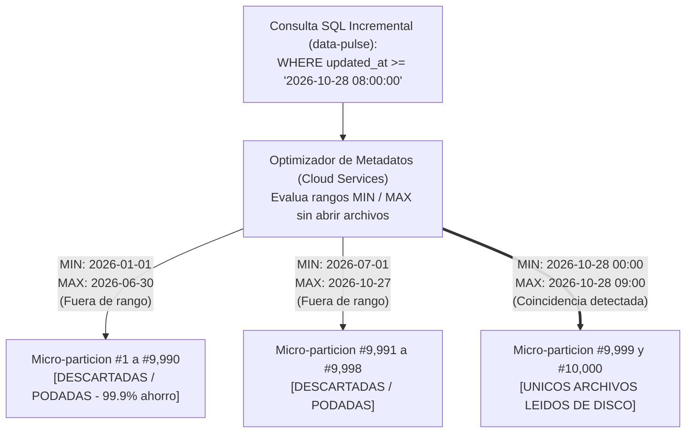

Cuando `data-pulse` ejecuta su consulta incremental filtrando por `updated_at`, Snowflake contrasta la fecha buscada contra los metadatos en milisegundos. Si de 10,000 micro-particiones totales, 9,998 tienen una fecha máxima anterior al corte solicitado, Snowflake las ignora por completo sin llegar a abrir los archivos en el disco duro (*Partition Pruning*). El motor lee únicamente las 2 micro-particiones relevantes, reduciendo el tráfico de entrada/salida y el tiempo de encendido del servidor en un **99.98%**.

### B. Degradación del Orden Natural y Uso Quirúrgico de `CLUSTER BY`
Por defecto, las micro-particiones se llenan siguiendo el orden cronológico en que llegan los datos. No obstante, en tablas de varios Terabytes que sufren actualizaciones desordenadas de registros antiguos y que son filtradas frecuentemente por múltiples dimensiones (por ejemplo, `updated_at` y `country_code`), los valores de fechas y países terminan dispersos en todas las micro-particiones.
1. **El Fenómeno del Solapamiento (*Overlapping Micro-partitions*):** Si todas las micro-particiones contienen registros desde el año 2021 hasta el 2026, el rango `MIN–MAX` de todas ellas se solapa con cualquier búsqueda. La poda fracasa y el motor cae en el peor escenario posible: un **Escaneo Completo de Tabla (*Full Table Scan*)**, abriendo el 100% de los archivos.
2. **Definición de Claves de Agrupación Física (`Clustering Keys`):** Para restaurar la eficiencia en tablas multimillonarias (>1 Terabyte), el Ingeniero de Datos declara una clave de ordenamiento físico:
   ```sql
   ALTER TABLE analytics_prod.marts.fct_customer_profitability
   CLUSTER BY (DATE_TRUNC('day', updated_at), country_code);
   ```
   Esto instruye a Snowflake para que reordene físicamente los registros en nuevas micro-particiones contiguas por día y país. *(Regla FinOps: Jamás se define `CLUSTER BY` en tablas pequeñas menores de 100 GB, dado que el servicio de reclustering automático en segundo plano factura créditos adicionales que no se justifican en volúmenes reducidos).*

---

## 5.2. Anatomía Física de los JOINs, Data Skew, Memory Spilling y Cortafuegos FinOps

Comprender cómo los nodos de un clúster distribuido cruzan tablas en la memoria RAM permite erradicar los dos mayores cuellos de botella de rendimiento en SQL: el **Sesgo de Datos (*Data Skew*)** y el **Derrame a Disco (*Memory Spilling*)**.

### A. Algoritmos Físicos de Cruce: Broadcast Join vs. Distributed Hash Join
Cuando un *Virtual Warehouse* de varios nodos (ej. talla *Medium* con 4 servidores en paralelo) ejecuta un `JOIN` entre dos tablas:
1. **Broadcast Join (Cruce por Difusión):** Si una de las tablas es pequeña (ej. una tabla dimensional de 50 países), el optimizador transmite una copia íntegra de esa tabla pequeña a la memoria RAM de los 4 nodos, permitiendo que cada nodo cruce su fragmento de la tabla gigante de hechos localmente sin tráfico de red ulterior.
2. **Distributed Hash Join (Cruce por Tabla Hash con Redistribución de Red):** Si ambas tablas contienen cientos de millones de filas, ningún nodo individual puede alojar una tabla completa en RAM. Los nodos aplican una función matemática *Hash* sobre la columna de cruce (`ON a.customer_id = b.customer_id`) y se envían las filas entre sí a través de la red interna (*Network Shuffle*) para garantizar que todos los registros de un mismo cliente aterricen exactamente en el mismo nodo físico.

### B. Los Dos Enemigos Silenciosos del Rendimiento Analítico

#### 1. Data Skew (Sesgo en la Distribución entre Nodos)
Si en un cruce millonario el 70% de las transacciones tienen `customer_id = NULL` o pertenecen a un código genérico como `"CONSUMIDOR_FINAL"`, la función *Hash* enviará ese 70% de los datos a **un único nodo del clúster**. Mientras que 3 de los 4 servidores terminan su trabajo en 2 segundos y permanecen ociosos al 0% de CPU, el nodo restante colapsa procesando cientos de millones de registros en solitario.
* **Mitigación Sénior:** Excluir o aislar las claves nulas y genéricas antes de ejecutar el `JOIN` distribuido, o salpimentar la clave de distribución (*Key Salting*).

#### 2. Memory Spilling (Derrame de Memoria a Disco Local y Remoto)
Cuando una consulta mal optimizada (por ejemplo, que selecciona decenas de columnas de texto innecesarias con `SELECT *` o ejecuta ordenamientos masivos `ORDER BY` / `DISTINCT` sin filtrar previamente) supera la memoria RAM física del nodo, el motor evita cancelar la consulta recurriendo al **Spilling**:
* **Spilling to Local SSD:** El nodo comienza a usar su disco duro local como memoria RAM improvisada. La consulta se ralentiza **entre 5 y 10 veces**.
* **Spilling to Remote Cloud Storage:** Si también se agota el disco SSD local, el nodo escribe y lee datos temporales a través de internet en el almacenamiento de objetos (Amazon S3). El rendimiento cae **hasta 100 veces** y el consumo de créditos se multiplica exponencialmente.

### C. Las Cuatro Leyes de Escritura SQL de Alto Rendimiento (Sargability & Pruning)
1. **Erradicación de `SELECT *`:** En almacenes columnares, proyectar únicamente las columnas estrictamente requeridas por el manifiesto de sincronización reduce linealmente el uso de RAM y evita el *Spilling*.
2. **Empuje Temprano de Predicados (*Predicate Pushdown*):** Aplicar los filtros `WHERE` en el primer bloque lógico (*CTE*) antes de realizar cualquier cruce (`JOIN`) o agregación (`GROUP BY`).
3. **Condiciones Sargables (*Search Argument Able*):** Jamás aplicar funciones de transformación sobre la columna filtrada en el lado izquierdo del operador:
   * *Antipatrón (Anula la poda y fuerza Full Table Scan):* `WHERE DATE_TRUNC('day', updated_at) = '2026-10-28'`
   * *Patrón Sénior (Preserva el Partition Pruning):* `WHERE updated_at >= '2026-10-28 00:00:00' AND updated_at < '2026-10-29 00:00:00'`
4. **Deduplicación Analítica con `QUALIFY`:** Sustituir el uso indiscriminado de `SELECT DISTINCT` (que oculta errores de cardinalidad en los cruces) por particionamiento determinista: `QUALIFY ROW_NUMBER() OVER (PARTITION BY customer_id ORDER BY updated_at DESC) = 1`.

### D. Los Tres Cortafuegos Financieros en Producción (FinOps Guardrails en `data-pulse`)
Dado que el consumo interno de créditos en Snowflake es responsabilidad directa del equipo de Ingeniería de Datos (y no del equipo de DevOps), el aprovisionamiento de infraestructura de `data-pulse` (`infra/snowflake/00_finops_guardrails.sql`) establece tres cortafuegos físicos obligatorios antes de ejecutar cualquier carga:

```sql
-- 1. CORTAFUEGOS DE TIEMPO MAXIMO DE EJECUCION (Evita consultas colgadas por 48h)
ALTER WAREHOUSE WH_DATA_PULSE_XS SET
    AUTO_SUSPEND = 60
    AUTO_RESUME = TRUE
    STATEMENT_TIMEOUT_IN_SECONDS = 300 -- Cancela automaticamente cualquier consulta que supere 5 minutos
    STATEMENT_QUEUED_TIMEOUT_IN_SECONDS = 120;

-- 2. CORTAFUEGOS PRESUPUESTARIO DURO (Resource Monitor con apagado de emergencia)
CREATE OR REPLACE RESOURCE MONITOR RM_DATA_PULSE_MONTHLY_GUARD
    WITH CREDIT_QUOTA = 50 -- Presupuesto maximo mensual asignado al motor
    FREQUENCY = MONTHLY
    START_TIMESTAMP = IMMEDIATELY
    TRIGGERS
        ON 75 PERCENT DO NOTIFY -- Alerta preventiva al equipo de ingenieria
        ON 95 PERCENT DO SUSPEND -- Suspende nuevas ejecuciones al finalizar la actual
        ON 100 PERCENT DO SUSPEND_IMMEDIATE; -- Corta la corriente en el acto para proteger la factura

ALTER WAREHOUSE WH_DATA_PULSE_XS SET RESOURCE_MONITOR = RM_DATA_PULSE_MONTHLY_GUARD;

-- 3. CORTAFUEGOS DE ESCALADO (Bloqueo de modificacion de talla por RBAC)
REVOKE MODIFY ON WAREHOUSE WH_DATA_PULSE_XS FROM ROLE ROLE_DATA_PULSE_SERVICE;
GRANT USAGE, OPERATE ON WAREHOUSE WH_DATA_PULSE_XS TO ROLE ROLE_DATA_PULSE_SERVICE;
```

---

## Glosario de Términos y Conceptos (Módulo 5)

* **Broadcast Join (Cruce por Difusión):** Estrategia de ejecución distribuida en la que una tabla de dimensiones pequeña se replica completa en la memoria RAM de todos los nodos de cálculo para cruzarla localmente con las particiones de una tabla masiva, evitando transferir la tabla grande por la red.
* **Cardinalidad:** Medida del número de valores únicos contenidos en una columna (alta cardinalidad en un identificador único; baja cardinalidad en un código de estado) o proporción numérica entre las filas que se relacionan en un cruce (`1:1`, `1:N`, `N:M`).
* **Clustering Key (Clave de Agrupación Física):** Subconjunto de una o más columnas definido explícitamente en Snowflake (`CLUSTER BY`) para ordenar físicamente el almacenamiento de datos dentro de las micro-particiones en tablas de múltiples Terabytes.
* **CTE (Common Table Expression):** Bloque de consulta temporal definido mediante la cláusula `WITH` que estructura consultas SQL complejas en pasos modulares, legibles y auditables.
* **Data Skew (Sesgo de Distribución de Datos):** Anomalía en sistemas de cómputo distribuido donde una clave desproporcionadamente frecuente concentra la mayor parte del volumen de datos en un único nodo del clúster, convirtiéndolo en un cuello de botella mientras el resto de los servidores permanecen inactivos.
* **Distributed Hash Join:** Algoritmo de cruce para tablas de gran volumen en el que los nodos del clúster redistribuyen las filas por la red interna (*Network Shuffle*) aplicando una función *hash* sobre la clave de unión para emparejar los registros en paralelo.
* **Full Table Scan (Escaneo Completo de Tabla):** Lectura exhaustiva del 100% de las micro-particiones de una tabla producida cuando el optimizador no puede descartar ningún archivo mediante los metadatos `MIN`/`MAX`.
* **Memory Spilling (Derrame de Memoria a Disco):** Degradación crítica de rendimiento que ocurre cuando los datos intermedios de una consulta SQL exceden la memoria RAM física del nodo y el motor se ve forzado a paginar datos hacia el disco SSD local (*Local Spilling*) o hacia el almacenamiento de objetos en la nube (*Remote Spilling*).
* **Network Shuffle (Redistribución por Red):** Tráfico interno de datos entre los servidores que conforman un clúster distribuido para agrupar registros con la misma clave durante operaciones `JOIN`, `GROUP BY` o funciones de ventana.
* **Partition Pruning (Poda de Particiones):** Mecanismo de optimización mediante el cual el motor analítico inspecciona las cabeceras de metadatos (`MIN`/`MAX`) de las micro-particiones y omite la lectura física de todos los archivos que no contienen valores dentro del rango solicitado en la cláusula `WHERE`.
* **Predicate Pushdown (Empuje de Predicados):** Optimización física y lógica que ejecuta los filtros de filas y selección de columnas en la etapa más cercana a la lectura del disco duro, reduciendo el volumen de datos que sube a la memoria RAM.
* **Resource Monitor (Monitor de Recursos Financieros en Snowflake):** Objeto de gobierno administrativo que rastrea en tiempo real el consumo de créditos de uno o varios *Virtual Warehouses* y ejecuta acciones automáticas de notificación o apagado forzoso (`SUSPEND_IMMEDIATE`) al alcanzar los umbrales presupuestarios definidos.
* **Sargable (Search Argument Able):** Expresión de filtro en una cláusula `WHERE` formulada de manera que la columna evaluada permanece limpia de funciones envolventes, permitiendo que el optimizador utilice directamente los metadatos de las micro-particiones para ejecutar la poda.
* **Statement Timeout (`STATEMENT_TIMEOUT_IN_SECONDS`):** Parámetro de seguridad FinOps que establece el límite máximo de segundos que una consulta SQL tiene permitido ejecutarse antes de ser abortada automáticamente por el motor, previniendo gastos descontrolados por bucles o cruces cartesianos accidentales.

---
---

# 6. Modelado Dimensional Avanzado (SCD) y Evolución de Esquemas (Data Contracts)

Las bases de datos corporativas no operan en el vacío estático: los clientes cambian de segmento fiscal, trasladan sus sedes geográficas y modifican sus contratos comerciales a lo largo del tiempo. Simultáneamente, los equipos de ingeniería de software que administran las aplicaciones de origen alteran la estructura de las tablas operativas sin previo aviso. 

Un Ingeniero de Datos Sénior diseña almacenes que preservan la verdad histórica para los modelos econométricos y blinda las tuberías mediante contratos de datos estrictos frente a mutaciones inesperadas.

## 6.1. Preservación de la Historia Económica: Slowly Changing Dimensions (SCD Tipos 1, 2 y 3)

Consideremos un escenario financiero real que conecta la capa de transformación (`METRICHUB`), el motor de inferencia causal (`CAUSAL-ML`) y el motor de activación (`DATA-PULSE`): 
La empresa corporativa **Cliente #500** operó durante todo el ejercicio 2025 bajo la categoría `"SME (Pequeña y Mediana Empresa)"` en la región `"EU-SOUTH"`. El 1 de julio de 2026, tras una expansión comercial, el cliente asciende a la categoría `"ENTERPRISE"` y reubica su matriz en la región `"EU-CENTRAL"`.

Si el almacén de datos simplemente sobrescribe (`UPDATE`) el registro del Cliente #500 con sus nuevos valores, **toda la contabilidad histórica queda contaminada**: cualquier análisis retrospectivo o modelo econométrico que evalúe el año 2025 adjudicará erróneamente las compras pasadas del cliente a la categoría `"ENTERPRISE"` y a la región `"EU-CENTRAL"`.

En el modelado dimensional de Ralph Kimball, la gestión temporal de los atributos se formaliza mediante las **Dimensiones Lentamente Cambiantes (*Slowly Changing Dimensions - SCD*)**:

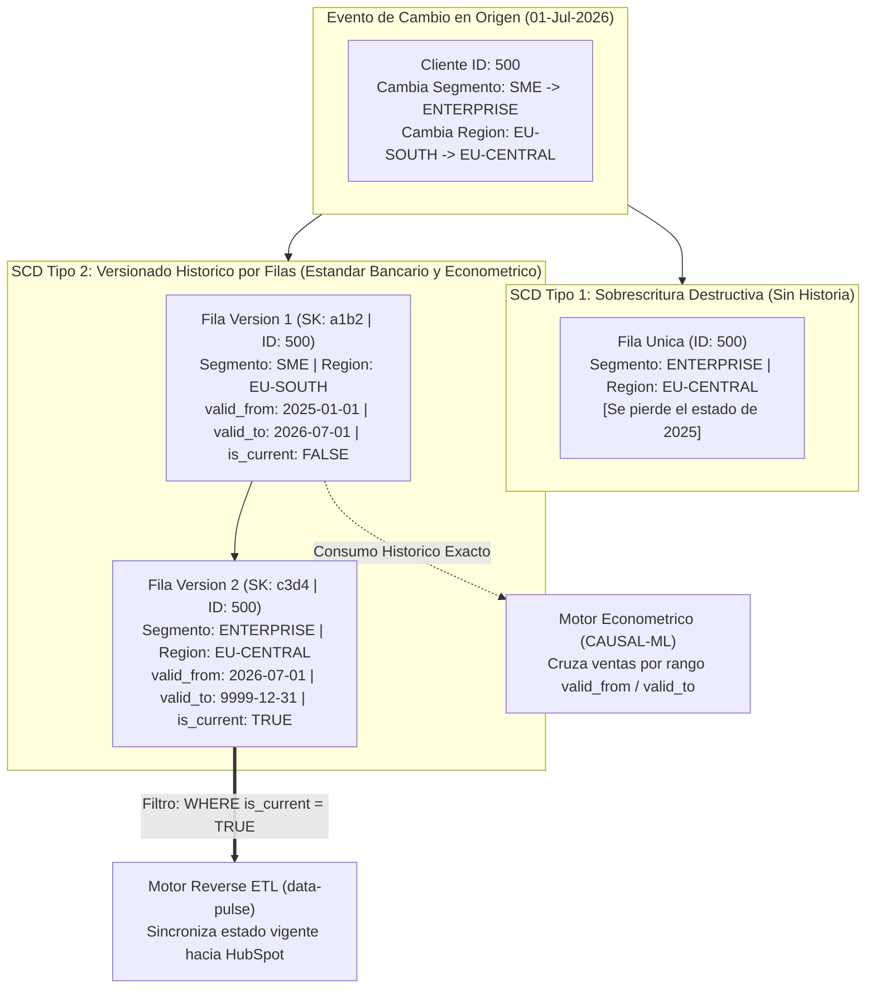

### A. Taxonomía de Estrategias SCD en Producción

| Tipo de SCD | Mecánica Técnica en Base de Datos | Impacto en el Análisis Histórico | Caso de Uso Arquitectónico |
| :--- | :--- | :--- | :--- |
| **SCD Tipo 1 (Overwrite)** | Actualiza directamente el valor antiguo por el nuevo (`UPDATE` / `MERGE`). No se crean nuevas filas ni se guarda historial. | **Nulo (Destructivo):** El pasado se reescribe con el valor presente. | Corrección de errores tipográficos en nombres, normalización de teléfonos o sincronización de la vista operativa actual en un CRM comercial. |
| **SCD Tipo 2 (Row Versioning)** | Cierra la vigencia de la fila anterior (`valid_to = current_timestamp`, `is_current = FALSE`) e inserta una nueva fila con una nueva clave subrogada (`surrogate_key`) y `is_current = TRUE`. | **Total (Auditabilidad 100%):** Permite reconstruir el estado exacto de la empresa en cualquier segundo del pasado. | Estudios de elasticidad precio y diferencias en diferencias (`CAUSAL-ML`), auditorías financieras (`ASSET-PIPE`) y reportes regulatorios. |
| **SCD Tipo 3 (Previous Value Column)** | Añade una columna específica en la misma fila (`previous_segment`, `current_segment`) y guarda únicamente el estado inmediatamente anterior. | **Parcial (Profundidad = 1):** Solo recuerda el último cambio, perdiendo cambios previos. | Campañas comerciales en CRMs que requieren identificar clientes que acaban de cambiar de categoría en el último ciclo mensual. |

### B. Integración de Tablas SCD Tipo 2 con Motores de Reverse ETL (`data-pulse`)
En una arquitectura corporativa madura, las dimensiones principales en Snowflake se automatizan como **SCD Tipo 2** utilizando el bloque nativo **`dbt snapshots`**. 
* Cuando los científicos de datos o economistas entrenan modelos de inferencia causal, cruzan la tabla de transacciones con la dimensión usando la ventana temporal de vigencia:
  ```sql
  FROM fct_invoices f
  INNER JOIN dim_customers_scd2 d
      ON f.customer_id = d.customer_id
     AND f.invoice_timestamp >= d.valid_from
     AND f.invoice_timestamp < d.valid_to
  ```
* Cuando el motor **`data-pulse`** extrae los indicadores para actualizar la ficha viva de los vendedores en HubSpot, consulta la vista final filtrando únicamente la versión activa (`WHERE is_current = TRUE`), combinando lo mejor de ambos mundos: memoria histórica perfecta en el almacén y estado operativo limpio en el CRM.

---

## 6.2. Evolución de Esquemas (Schema Drift), Contratos de Datos y Patrón WAP

El segundo desafío estructural de las tuberías de datos ocurre cuando los sistemas de origen mutan sin coordinación previa con el equipo de ingeniería de datos.

### A. El Fenómeno del Schema Drift (Deriva de Esquema)
Se denomina **Schema Drift** a cualquier alteración no anunciada en la estructura, nombres de campos o tipos de datos de una fuente:
1. **Cambio Semántico o de Tipo (*Breaking Change*):** Una columna `discount_rate` que enviaba valores decimales (`0.15`) comienza a enviar cadenas de texto con el símbolo de porcentaje (`"15%"`), o un campo numérico devuelve cadenas `"N/A"`.
2. **Eliminación o Renombrado de Columnas:** El equipo de desarrollo web renombra `user_email` a `primary_contact_email`.
3. **Adición de Columnas Nuevas:** Se agregan nuevos atributos al objeto JSON de origen.

Si una tubería carece de defensas formales contra el *Schema Drift*, el fallo puede corromper silenciosamente las métricas financieras o inyectar valores nulos masivos en las herramientas comerciales de la empresa.

### B. Defensa en Profundidad: Contratos de Datos (Pydantic & Zod) y Patrón Write-Audit-Publish (WAP)

En la arquitectura de nuestros proyectos (`ASSET-PIPE`, `METRICHUB` y `DATA-PULSE`), ningún dato se procesa ni se publica "de buena fe". Implementamos una aduana de validación en dos niveles:

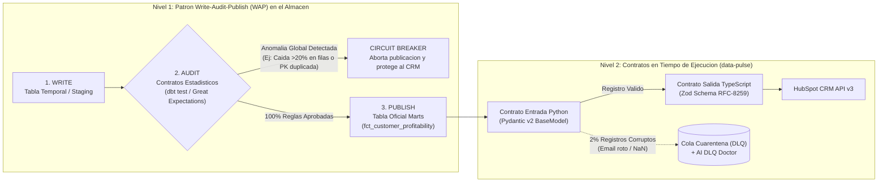

#### 1. El Patrón Arquitectónico Write-Audit-Publish (WAP) y el Cortacircuitos (Circuit Breaker)
Antes de que una tabla quede disponible para que `data-pulse` la envíe a los CRMs, el flujo en el almacén aplica tres fases estrictas:
* **Write (Escritura Aislada):** Los datos recién transformados se escriben en una tabla candidata oculta al negocio.
* **Audit (Auditoría Automatizada de Calidad y Volumetría):** Se ejecutan pruebas formales (`dbt test` o `Great Expectations`) que verifican invariantes matemáticos:
  * Unicidad absoluta de la clave primaria (`customer_id`).
  * Ausencia de valores nulos en campos obligatorios.
  * **Control Estadístico de Volumetría:** Si la tabla tenía ayer 50,000 clientes activos y hoy la ejecución arroja solo 50 filas debido a una caída en el sistema de origen, el auditor detecta una desviación anormal ($>20\%$).
* **Publish o Circuit Breaker (Publicación o Disparo del Fusible):** Si la auditoría general falla, salta el **Cortacircuitos (*Circuit Breaker*)**: la tabla candidata se descarta, la tabla oficial conserva la última versión sana conocida y Apache Airflow cancela preventivamente el envío hacia HubSpot, evitando contaminar el CRM de ventas.

#### 2. Contratos de Datos Ejecutables a Nivel de Fila (Pydantic v2 en Python y Zod en TypeScript)
Superada la auditoría macroscópica de la tabla, durante la extracción de `data-pulse` cada fila individual es sometida a contratos de memoria en tiempo de ejecución:
* **En Python (`core-engine` con Pydantic v2):** Escrito sobre un núcleo compilado en Rust, Pydantic valida cada diccionario extraído de Snowflake/DuckDB contra una clase fuertemente tipada (`CustomerProfitabilityRecord`). Verifica que los importes monetarios sean números finitos, que los códigos de moneda cumplan el estándar de tres letras **ISO-4217** (`USD`, `EUR`) y que las fechas estén normalizadas en **ISO-8601 UTC**.
* **En TypeScript (`connectors-ts` con Zod):** Actúa como contrato de frontera específico para el proveedor externo. Garantiza que el objeto JSON cumpla las restricciones exactas del endpoint `/batch/upsert` de HubSpot antes de abrir el socket de red. Cualquier fila individual que viole el contrato de Pydantic o de Zod es interceptada sin detener el proceso y derivada limpiamente a la *Dead-Letter Queue*.

---

## Glosario de Términos y Conceptos (Módulo 6)

* **Business Key (Clave Natural o de Negocio):** Identificador único de una entidad generado por los procesos del mundo real o sistemas operativos de la empresa (ej. número de identificación fiscal, correo electrónico o `customer_id`). En una tabla histórica SCD Tipo 2, una misma *Business Key* se repite en múltiples filas para reflejar sus distintos estados a través del tiempo.
* **Circuit Breaker (Patrón Cortacircuitos):** Mecanismo de protección automática en ingeniería de sistemas que interrumpe la ejecución completa de una tubería cuando detecta un fallo sistémico o una caída masiva en la calidad de los datos de entrada, impidiendo que el error se propague hacia los sistemas de destino.
* **dbt Snapshots:** Mecanismo declarativo integrado en *dbt Core* que implementa tablas históricas **SCD Tipo 2** de forma automatizada, detectando cambios en las columnas vigiladas y gestionando por sí mismo las marcas temporales `dbt_valid_from` y `dbt_valid_to`.
* **Great Expectations:** Marco de trabajo de código abierto en Python especializado en la validación estadística y documental de datos mediante aserciones declarativas llamadas "expectativas" (ej. verificar que los valores de una columna se mantengan dentro de tres desviaciones estándar respecto a su media histórica).
* **ISO-4217 / ISO-8601:** Normas técnicas internacionales esenciales en contratos de datos: **ISO-4217** estandariza los códigos alfabéticos de tres letras para divisas monetarias (`USD`, `EUR`, `GBP`) y **ISO-8601** estandariza la representación inequívoca de fechas y horas con zona horaria (`2026-10-28T08:00:00Z`).
* **NaN / Infinity (Not a Number / Infinito):** Valores especiales de punto flotante (estándar IEEE 754) producidos por operaciones matemáticas indeterminadas como divisiones entre cero (`0.0 / 0.0`). Dado que el estándar oficial de intercambio JSON (RFC 8259) prohíbe explícitamente la presencia de `NaN` e `Infinity`, los contratos de datos deben interceptarlos antes de serializar cualquier carga útil HTTP.
* **Patrón WAP (Write-Audit-Publish):** Arquitectura de control de calidad en tres etapas donde los datos se escriben primero en un entorno de cuarentena o preparación (*Write*), se someten a pruebas exhaustivas de integridad y volumetría (*Audit*) y únicamente se exponen al consumo del negocio si superan todas las validaciones (*Publish*).
* **Pydantic (v2):** Librería estándar de validación de datos y gestión de configuraciones en Python cuyo motor interno está implementado en lenguaje Rust, permitiendo validar estructuras complejas de datos a velocidades cercanas al código nativo.
* **Schema Drift (Deriva de Esquema):** Modificación imprevista en los nombres de columnas, tipos de datos o estructura jerárquica de una fuente de datos operativa que amenaza con romper o corromper las tuberías analíticas aguas abajo.
* **Slowly Changing Dimension (SCD):** Conjunto de metodologías de diseño dentro del modelado dimensional de Kimball para gestionar la evolución temporal de los atributos en las tablas de dimensiones: **Tipo 1** (sobrescritura sin memoria), **Tipo 2** (creación de nuevas filas versionadas con rangos de fechas de validez) y **Tipo 3** (almacenamiento del valor inmediato anterior en una columna adicional).
* **Surrogate Key (Clave Subrogada o Artificial):** Identificador técnico único e inmutable (habitualmente generado mediante una función *hash* determinista como `MD5(customer_id || valid_from)`) que actúa como clave primaria de cada versión específica de una fila dentro de una tabla SCD Tipo 2.


---
---

# 7. Seguridad Corporativa, Criptografía Aplicada a Datos y Gobernanza (SecOps)

En arquitecturas empresariales que procesan indicadores financieros, carteras de inversión y datos de clientes (como los motores `ASSET-PIPE`, `CAUSAL-ML` y `DATA-PULSE`), la seguridad de la información no es un complemento posterior al desarrollo, sino una restricción estructural de diseño. Un fallo en la custodia de credenciales o la exposición de Información Personal Identificable (PII) conlleva sanciones regulatorias severas (hasta el 4% de la facturación global anual bajo la normativa europea GDPR) y la pérdida irreversible de reputación corporativa.

El Ingeniero de Datos Sénior implementa sus sistemas bajo los principios de **Seguridad desde el Diseño (*Security by Design*)**, **Confianza Cero (*Zero Trust*)** y **Mínimo Privilegio (*Principle of Least Privilege - PoLP*)**.

## 7.1. Gestión Profesional de Secretos, Autenticación Criptográfica RSA y Mínimo Privilegio

Una vulnerabilidad crítica en auditorías de ingeniería consiste en incrustar contraseñas, claves de API o cadenas de conexión directamente dentro del código fuente (*Hardcoded Credentials*) o confirmar accidentalmente archivos de configuración `.env` en repositorios Git. Los sistemas automatizados de rastreo explotan credenciales expuestas en repositorios públicos en cuestión de segundos.

### A. Arquitectura del Ciclo de Vida de los Secretos según el Entorno
1. **Entorno de Desarrollo Local (Docker / WSL2):** Las variables sensibles se inyectan exclusivamente a través de un archivo `.env` local excluido de forma estricta mediante `.gitignore`. En el control de versiones solo se publica el esquema de referencia `.env.example` desprovisto de valores reales.
2. **Entorno de Integración y Despliegue Continuo (GitHub Actions):** Las claves se custodian cifradas en el almacén de **GitHub Encrypted Secrets** y se exponen únicamente en la memoria volátil del contenedor efímero durante la ejecución de las pruebas de integración.
3. **Entorno de Producción Empresarial (Cloud Secrets Managers):** Ningún servidor de producción almacena contraseñas en texto plano en el disco duro. El orquestador Apache Airflow y el motor `data-pulse` recuperan las credenciales en tiempo de ejecución desde bóvedas centralizadas y auditadas (**AWS Secrets Manager**, **Google Secret Manager** o **HashiCorp Vault**), las cuales ejecutan políticas de rotación automática de claves cada 30 o 90 días.

### B. Autenticación Criptográfica por Par de Llaves Asimétricas en Snowflake (RSA Key-Pair)
Mientras que los usuarios humanos acceden a la interfaz web de Snowflake (*Snowsight*) mediante contraseña y autenticación multifactor (**MFA** interactivo en dispositivo móvil), los procesos desatendidos como `data-pulse` —que se ejecutan de madrugada sin intervención humana— no pueden depender de aprobaciones manuales en un teléfono ni de contraseñas estáticas vulnerables a ataques de fuerza bruta.

El estándar industrial para cuentas de servicio (*Service Accounts* como `SVC_DATA_PULSE`) es la **Autenticación por Par de Llaves Criptográficas RSA de 2048 bits (PKCS#8)**:

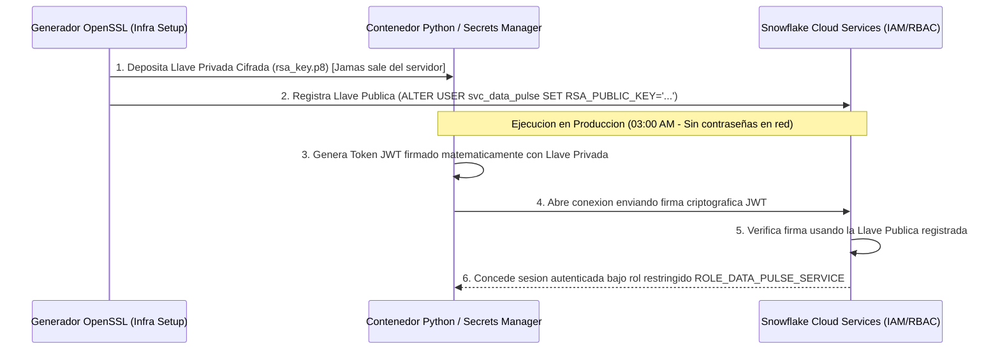

1. Se genera un par de claves asimétricas matemáticamente vinculadas: una **Llave Privada** (`rsa_key.p8`) y una **Llave Pública** (`rsa_key.pub`).
2. La **Llave Pública** se asigna al usuario de servicio dentro de Snowflake. Por las propiedades de la criptografía asimétrica, es computacionalmente inviable deducir la llave privada a partir de la llave pública.
3. En cada sincronización, el motor Python firma un *JSON Web Token (JWT)* temporal utilizando su **Llave Privada** y lo presenta ante Snowflake, quien valida la autenticidad de la firma en milisegundos sin que jamás viaje una contraseña por la red.

### C. Principio de Mínimo Privilegio (PoLP) mediante RBAC Quirúrgico
Asumiendo el axioma de Confianza Cero (*"diseñar como si el perímetro ya hubiera sido vulnerado"*), la cuenta de servicio de `data-pulse` jamás opera bajo roles administrativos (`ACCOUNTADMIN` o `SYSADMIN`). En el script de seguridad `infra/snowflake/01_security_rbac.sql`, se aprovisiona el rol restringido `ROLE_DATA_PULSE_SERVICE`:
* Carece de privilegios para eliminar, truncar o alterar tablas (`DROP`, `TRUNCATE`, `DELETE`, `ALTER` revocados).
* Carece de visibilidad sobre esquemas de recursos humanos, contabilidad cruda o datos no autorizados.
* Posee exclusivamente el privilegio `SELECT` sobre la vista gobernada `analytics_prod.marts.fct_customer_profitability` y privilegios `INSERT` / `UPDATE` circunscritos a su tabla técnica de auditoría y cuarentena (`audit.data_pulse_dlq`).

---

## 7.2. Protección de Datos Sensibles (PII), Pseudonimización con Salt y Seguridad en Tránsito

### A. Anonimización vs. Pseudonimización Criptográfica (`SHA-256` + Cryptographic Salt)
En modelos econométricos (`CAUSAL-ML`) y reconciliación de activos (`ASSET-PIPE`), es frecuente necesitar cruzar las operaciones históricas de un mismo individuo a través de múltiples tablas sin exponer su identidad real (correo electrónico o documento nacional de identidad) ante los analistas o científicos de datos.

1. **El Riesgo del Hashing Directo (Vulnerabilidad a Rainbow Tables):** Si un ingeniero aplica una función resumen directa como `SHA2(email, 256)` o `MD5(dni)`, el resultado parece ilegible (`8f434346...`). Sin embargo, dado que el espacio de números de documentos de identidad o correos corporativos es finito y predecible, un atacante puede precalcular una tabla de equivalencias masiva (**Rainbow Table**) y revertir millones de identificadores por simple comparación.
2. **La Solución Sénior: Hashing con Sal Criptográfica (*Salted SHA-256*):** Antes de aplicar la función criptográfica unidireccional, el dato original se concatena con una cadena secreta de alta entropía custodiada en el gestor de secretos de la organización (**Salt**):
   $$\text{Pseudonym\_ID} = \text{SHA256}\left(\text{LOWER}(\text{TRIM}(\text{identificador\_pii})) \mathbin{\Vert} \text{SECRET\_PEPPER\_SALT}\right)$$
   Este procedimiento garantiza el determinismo relacional (el mismo cliente produce idéntica clave subrogada en todas las tablas del almacén, permitiendo ejecutar `JOINs` exactos), pero invalida matemáticamente cualquier intento de inversión mediante tablas precalculadas.

### B. Gobernanza Nativa en Snowflake: Dynamic Data Masking y Row-Level Security (RLS)
Para evitar la proliferación de tablas duplicadas según el nivel de autorización del consumidor, Snowflake aplica políticas de seguridad dinámicas sobre una **Única Fuente de Verdad (*Single Source of Truth*)**:

```sql
-- Politica de Enmascaramiento Dinamico a Nivel de Columna (Dynamic Data Masking)
CREATE OR REPLACE MASKING POLICY governance.pii_email_mask AS (val STRING) RETURNS STRING ->
    CASE
        -- El motor data-pulse requiere el email real para el emparejamiento en HubSpot API
        WHEN CURRENT_ROLE() IN ('ROLE_DATA_PULSE_SERVICE', 'ACCOUNTADMIN') THEN val
        -- Los analistas de BI y cientificos de datos ven el dominio ofuscado
        ELSE REGEXP_REPLACE(val, '^[^@]+', '*****')
    END;

ALTER TABLE analytics_prod.marts.fct_customer_profitability
    MODIFY COLUMN email SET MASKING POLICY governance.pii_email_mask;
```

Adicionalmente, mediante **Políticas de Acceso a Nivel de Fila (*Row Access Policies - RLS*)**, el almacén filtra de forma transparente qué registros horizontales devuelve un `SELECT` en función de la filial geográfica o unidad de negocio a la que pertenece el rol ejecutor.

### C. Integridad Criptográfica en Conectores de Salida TypeScript (TLS 1.3 y Firmas HMAC-SHA256)
Cuando los conectores de salida de `data-pulse` transmiten cargas útiles JSON a través de internet hacia Webhooks corporativos o APIs receptoras, se imponen dos controles de transporte:
1. **Cifrado de Canal (TLS 1.3 / HTTPS Estricto):** El cliente HTTP en TypeScript rechaza en tiempo de validación cualquier URL de destino que no opere sobre protocolo seguro cifrado.
2. **Autenticación de Mensajes mediante Firma HMAC (`HMAC-SHA256`):** Para garantizar al servidor receptor que el paquete JSON proviene legítimamente de `data-pulse` y que ningún intermediario ha alterado los importes financieros en tránsito, el conector calcula un código de autenticación de mensaje basado en *hash* combinando el sello temporal de la petición, el cuerpo exacto del JSON y una llave secreta compartida:
   $$\text{Signature} = \text{HMAC-SHA256}\left(\text{Secret\_Key}, \, \text{Timestamp} \mathbin{\Vert} \text{"."} \mathbin{\Vert} \text{Raw\_JSON\_Body}\right)$$
   La firma resultante se adjunta en la cabecera HTTP `X-DataPulse-Signature-256`, permitiendo al receptor verificar la integridad absoluta del lote en menos de un milisegundo.

---

## Glosario de Términos y Conceptos (Módulo 7)

* **Anonimización vs. Pseudonimización:** La *Anonimización* destruye de forma irreversible cualquier vínculo entre el dato y el individuo original. La *Pseudonimización* reemplaza los atributos identificativos directos por un código criptográfico consistente (*hash* con *salt*), permitiendo el cruce estadístico y econométrico de registros sin revelar la identidad personal en pantalla.
* **Criptografía Asimétrica (RSA Key-Pair):** Sistema criptográfico basado en un par de llaves matemáticamente complementarias: una *Llave Privada* secreta utilizada para firmar digitalmente las solicitudes de conexión y una *Llave Pública* registrada en el servidor de destino para verificar dicha firma, eliminando el tránsito de contraseñas por la red.
* **Dynamic Data Masking (Enmascaramiento Dinámico de Datos):** Característica de gobierno en almacenes como Snowflake que transforma u oculta en tiempo real el contenido de columnas sensibles (PII) en el instante en que se ejecuta una consulta `SELECT`, dependiendo del rol de seguridad que posea el usuario consultante.
* **Hardcoded Credentials (Credenciales Incrustadas):** Mala práctica crítica de seguridad consistente en escribir contraseñas, llaves privadas o tokens directamente en el código fuente en lugar de inyectarlos mediante variables de entorno o bóvedas de secretos.
* **HMAC-SHA256 (Hash-based Message Authentication Code):** Algoritmo criptográfico utilizado en comunicaciones Webhook y APIs financieras para firmar cargas útiles JSON mediante una clave secreta compartida, garantizando simultáneamente la autenticidad del emisor y que ningún byte del mensaje fue modificado en el trayecto.
* **JWT (JSON Web Token):** Estándar abierto (RFC 7519) para la transmisión segura y compacta de credenciales e identidad entre dos sistemas mediante un objeto JSON firmado digitalmente.
* **MFA (Multi-Factor Authentication):** Protocolo de control de acceso que exige al usuario validar su identidad mediante dos o más factores independientes (contraseña conocida más un token temporal físico o biométrico).
* **Principio de Mínimo Privilegio (PoLP - Principle of Least Privilege):** Directriz de ciberseguridad que establece que cada cuenta de servicio, contenedor o usuario humano debe recibir única y exclusivamente los permisos mínimos indispensables para ejecutar su función autorizada.
* **Rainbow Table (Tabla Arcoíris):** Base de datos masiva de códigos *hash* precalculados a partir de diccionarios de palabras, correos y secuencias numéricas (como documentos de identidad), empleada por atacantes para descubrir el texto original detrás de un *hash* simple sin *salt*.
* **Row-Level Security (RLS - Seguridad a Nivel de Fila):** Mecanismo de gobierno de bases de datos que restringe automáticamente qué filas de una tabla puede visualizar o extraer cada usuario en función de sus atributos organizacionales o regionales.
* **Salt / Pepper (Sal y Pimienta Criptográfica):** Cadenas de caracteres secretas y de alta aleatoriedad que se concatenan a un dato sensible antes de aplicarle una función *hash* (`SHA-256`), neutralizando por completo los ataques basados en *Rainbow Tables*.
* **Secrets Manager (Gestor de Secretos Cloud):** Servicio de infraestructura blindada (como *AWS Secrets Manager* o *HashiCorp Vault*) diseñado para almacenar, auditar, entregar en memoria y rotar periódicamente credenciales de bases de datos y llaves criptográficas.
* **Service Account (Cuenta de Servicio):** Identidad técnica no humana aprovisionada en una plataforma Cloud o base de datos para uso exclusivo de procesos automatizados y contenedores de producción.
* **Zero Trust (Arquitectura de Confianza Cero):** Paradigma de seguridad informática que elimina la confianza implícita por ubicación de red, exigiendo autenticación criptográfica, autorización mínima y cifrado en cada interacción entre microservicios.

---
---

# 8. Arquitectura de Datos Moderna Comparada: El Criterio del Arquitecto

Una de las competencias centrales de un Ingeniero de Datos Sénior o Arquitecto de Plataforma es la capacidad de seleccionar las herramientas tecnológicas de un proyecto basándose en **criterios físicos, volumétricos y financieros objetivos**, evitando tanto la sobreingeniería (utilizar un clúster distribuido masivo para procesar cien mil filas) como la infraingeniería (intentar procesar cincuenta millones de filas con librerías de un solo hilo en memoria).

## 8.1. Motores de Procesamiento en Python: Pandas vs. Polars vs. DuckDB vs. PySpark

Cuando el procesamiento ocurre fuera del Data Warehouse —por ejemplo, en la ingesta y reconciliación de carteras financieras (`ASSET-PIPE`) o en la extracción y preparación local de lotes (`DATA-PULSE`)—, el ecosistema Python ofrece cuatro motores con arquitecturas internas radicalmente distintas:

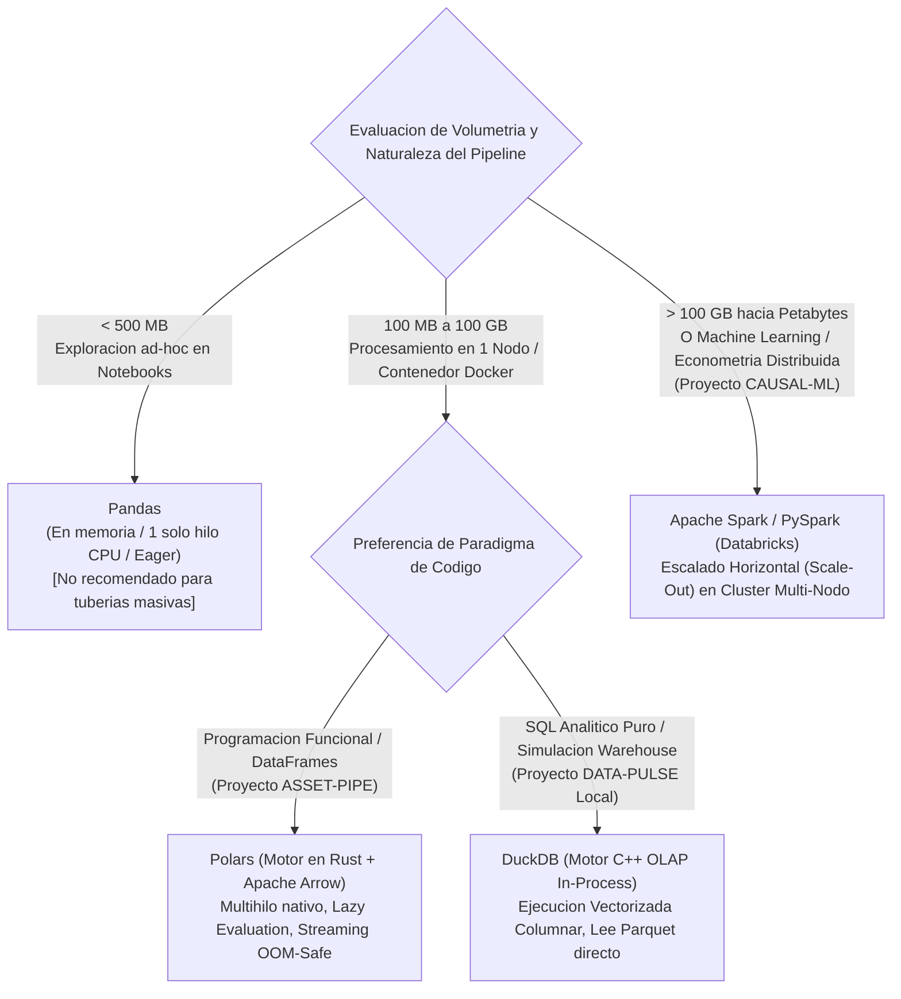

### A. Análisis Comparativo de Arquitectura Interna y Rendimiento

| Atributo Técnico | **Pandas** | **Polars** | **DuckDB** | **Apache Spark (PySpark)** |
| :--- | :--- | :--- | :--- | :--- |
| **Lenguaje del Núcleo Interno** | Python / C (Legado) | **Rust** (Nativo sin GIL) | **C++** (Vectorizado) | Scala / Java (**JVM**) |
| **Representación en Memoria RAM** | Arreglos NumPy orientados a filas/bloques | **Apache Arrow** Columnar | Bloques Columnares Vectorizados | RDD / Catalyst Internal Rows |
| **Uso de Núcleos de CPU** | **Monohilo (Single-Core)** en la mayoría de operaciones | **Multihilo Automático (100% de núcleos)** | **Multihilo Automático (100% de núcleos)** | **Distribuido Multi-Servidor** |
| **Modelo de Evaluación** | *Eager* (Ansiosa: ejecuta línea por línea creando copias en RAM) | *Eager* y **Lazy** (Optimiza el plan completo antes de ejecutar) | **Optimizador SQL Completo** con *Predicate Pushdown* | **Lazy** (Construye un DAG en el optimizador *Catalyst*) |
| **Multiplicador de Memoria RAM requerido** | **5x a 10x** el tamaño del conjunto de datos | **1.5x a 2x** (o menor usando modo *Streaming*) | Opera con presupuesto fijo de RAM; derrama a disco local sin caer | Escala sumando la RAM de múltiples máquinas virtuales |
| **Rango Óptimo de Volumetría** | $< 500\text{ MB}$ | **$100\text{ MB} \text{ a } 100\text{ GB}$** | **$100\text{ MB} \text{ a } 100\text{ GB}$** | **$> 100\text{ GB} \text{ a Petabytes}$** |

### B. El Criterio FinOps: Escalado Vertical Moderno (Polars/DuckDB) frente al Impuesto de Spark
Durante la década pasada, cualquier volumen de datos superior a 10 Gigabytes obligaba a las empresas a levantar costosos clústeres de **Apache Spark** porque Pandas colapsaba la memoria RAM. Sin embargo, los clústeres distribuidos pagan un alto **"impuesto de coordinación"**: requieren varios minutos para encender las máquinas virtuales de Java (JVM), serializar datos y moverlos por la red entre servidores (*Shuffle*).

Hoy, gracias a los motores escritos en Rust y C++ sobre memoria **Apache Arrow** (**Polars** y **DuckDB**), un único contenedor o servidor moderno con 8 o 16 núcleos y disco NVMe procesa entre 10 GB y 100 GB de archivos Apache Parquet en segundos, sin latencia de arranque de clúster y por una fracción centesimal del costo en la nube. Un Arquitecto Sénior utiliza **Polars/DuckDB** por defecto para cargas en un solo nodo (`ASSET-PIPE` y `DATA-PULSE`) y reserva **Databricks/PySpark** estrictamente para volúmenes masivos multi-terabyte o cargas de entrenamiento econométrico y Machine Learning distribuido (`CAUSAL-ML`).

---

## 8.2. Almacenes Analíticos Cloud y Estándares Abiertos: Snowflake vs. BigQuery vs. Databricks e Iceberg

El dominio de los tres grandes almacenes analíticos del mercado (**Snowflake**, **Google BigQuery** y **Databricks**) junto con los formatos abiertos de almacenamiento (**Apache Parquet** y **Apache Iceberg**) dota al ingeniero de versatilidad multi-nube completa.

### A. Matriz de Decisión Arquitectónica entre Plataformas Cloud

| Dimensión de Evaluación | **Snowflake** (`DATA-PULSE` / `ASSET-PIPE`) | **Google BigQuery** (`METRICHUB`) | **Databricks Lakehouse** (`CAUSAL-ML`) |
| :--- | :--- | :--- | :--- |
| **Paradigma de Infraestructura** | *Data Warehouse* con cómputo desacoplado por tallas (*Virtual Warehouses* XS–6XL). | Motor *100% Serverless* basado en asignación dinámica de *Slots* masivos. | Plataforma unificada *Data Lakehouse* sobre motores Apache Spark y Photon. |
| **Unidad de Facturación** | **Por Segundo de Cómputo Activo** (Créditos consumidos mientras el Warehouse está encendido). | **Por Volumen de Datos Leídos** (~$6.25 USD por Terabyte escaneado en modo bajo demanda) o capacidad *Slots*. | **DBUs (Databricks Units)** más el costo directo de las instancias EC2/VMs del proveedor Cloud. |
| **Riesgo Financiero Principal y Mitigación FinOps** | *Riesgo:* Dejar Warehouses grandes encendidos sin actividad.<br>*Mitigación:* `AUTO_SUSPEND = 60s` y `Resource Monitors`. | *Riesgo:* Lanzar consultas reiteradas sobre tablas de muchos Terabytes sin particionar.<br>*Mitigación:* Particionamiento por fecha obligatorio y `maximum_bytes_billed`. | *Riesgo:* Clústeres interactivos de *Notebooks* olvidados encendidos.<br>*Mitigación:* *Job Clusters* efímeros que se destruyen al terminar el script. |
| **Fortaleza Diferencial** | Rendimiento SQL predecible, gobierno RBAC/Masking superior, *Zero-Copy Cloning* y *Time Travel*. | Cero administración de tamaños de servidor; ideal para capas semánticas dbt y consultas esporádicas de BI. | Ecosistema nativo para Python avanzado, inferencia causal, econometría y *Machine Learning* a escala. |

### B. La Revolución de los Formatos Abiertos: Apache Parquet y Apache Iceberg
En la ingeniería de datos profesional, el uso de formatos de texto plano como `.CSV` para almacenamiento intermedio está proscrito debido a su ausencia de compresión, lectura secuencial por filas y pérdida total del tipado de datos. La industria opera sobre dos estándares abiertos:

1. **Apache Parquet (El Estándar Físico de Archivo Columnar):**
   Formato binario comprimido que almacena los datos organizados por columnas e incrusta en el pie del archivo (*Footer*) tanto el esquema exacto de tipos de datos como las estadísticas `MIN`/`MAX` de cada grupo de filas (*Row Groups*). Reduce el espacio en disco hasta un 90% frente a CSV y permite a Polars, DuckDB y Snowflake leer únicamente las columnas solicitadas.
2. **Apache Iceberg (El Estándar Abierto de Tablas Transaccionales):**
   Un conjunto de archivos Parquet sueltos en Amazon S3 carece de capacidades transaccionales: no permite actualizar una fila específica de forma atómica ni viajar en el tiempo. **Apache Iceberg** añade una capa de catálogo y árboles de metadatos JSON/Avro sobre los archivos Parquet en el almacenamiento de objetos del cliente (S3, GCS, Azure Blob), dotándolos de **transacciones ACID completas, evolución de esquemas sin reescritura, particionamiento oculto y *Time Travel***.
   * **Impacto Estratégico (Interoperabilidad sin Copia):** Al adoptar tablas Apache Iceberg, una organización almacena sus datos una única vez en su propio cubo de Amazon S3 y permite que **Databricks** ejecute modelos econométricos sobre ellos (`CAUSAL-ML`), **Snowflake** los gobierne y **Polars/DuckDB** los consuman para activación operativa (`DATA-PULSE`), eliminando la duplicación de datos y el bloqueo de proveedor (*Vendor Lock-in*).

---

## Glosario de Términos y Conceptos (Módulo 8)

* **ACID (Atomicity, Consistency, Isolation, Durability):** Conjunto de propiedades que garantizan la integridad de las operaciones en una base de datos incluso ante fallos de hardware o accesos concurrentes: *Atomicidad* (todo el lote se aplica o nada se aplica), *Consistencia* (se respetan todas las reglas del esquema), *Aislamiento* (dos procesos simultáneos no se corrompen entre sí) y *Durabilidad* (una vez confirmada la transacción, persiste en disco).
* **Apache Arrow:** Especificación estándar de la industria para estructurar datos tabulares columnares directamente en la **memoria RAM**, permitiendo transferir grandes volúmenes de datos entre lenguajes y motores (Python, Rust, C++, Polars, DuckDB, Snowflake) sin costo de serialización (*Zero-Copy*).
* **Apache Iceberg:** Formato abierto de tablas de alto rendimiento que aporta capacidades de Data Warehouse (transacciones ACID, *Time Travel*, *Schema Evolution*) directamente sobre archivos Apache Parquet alojados en un Data Lake económico.
* **Apache Parquet:** Formato de archivo binario, comprimido y orientado a columnas diseñado para el almacenamiento y lectura eficiente de grandes volúmenes de datos analíticos.
* **Data Lake vs. Data Warehouse vs. Data Lakehouse:** El *Data Lake* es un repositorio de almacenamiento de objetos de bajo costo (ej. AWS S3) para archivos en cualquier formato. El *Data Warehouse* es un almacén relacional estructurado de alto rendimiento y gobierno para analítica SQL. El *Data Lakehouse* unifica ambos mundos implementando formatos transaccionales abiertos (como Apache Iceberg o Delta Lake) sobre el almacenamiento económico del Data Lake.
* **Eager Evaluation vs. Lazy Evaluation:** En la *Evaluación Ansiosa (Eager)*, cada instrucción de transformación se ejecuta inmediatamente en memoria tal como fue escrita. En la *Evaluación Perezosa (Lazy)*, el motor posterga la ejecución hasta construir un grafo completo de la consulta, aplicando optimizaciones matemáticas globales (*Predicate Pushdown*, eliminación de columnas no usadas) antes de tocar los datos físicos.
* **Escalado Vertical (Scale-Up) vs. Escalado Horizontal (Scale-Out):** *Scale-Up* consiste en incrementar la potencia (CPU/RAM) de un único servidor para procesar datos sin latencia de red (enfoque de Polars y DuckDB). *Scale-Out* consiste en distribuir la carga entre múltiples servidores interconectados en un clúster (enfoque de Apache Spark).
* **JVM (Java Virtual Machine):** Máquina virtual sobre la que se ejecutan lenguajes como Scala y Java, y que constituye el motor base de Apache Spark.
* **Rust:** Lenguaje de programación de sistemas compilado que garantiza seguridad de memoria sin recolector de basura (*Garbage Collector*) y concurrencia sin condiciones de carrera, utilizado para construir el núcleo de herramientas de datos de última generación como Polars y Pydantic v2.
* **Serverless (Cómputo sin Servidor Visible):** Modelo de ejecución en la nube donde el proveedor asigna y retira capacidad de procesamiento dinámicamente en milisegundos por cada consulta sin que el ingeniero tenga que aprovisionar ni dimensionar máquinas virtuales.
* **TCO (Total Cost of Ownership / Costo Total de Propiedad):** Evaluación financiera integral de una solución tecnológica que suma los costos directos de infraestructura Cloud, las licencias de software y el costo salarial de las horas de ingeniería requeridas para su operación y mantenimiento.

---
---

# 9. CI/CD para Datos, Despliegue a Producción, Entregables Ejecutivos y Supervivencia en Producción

Una arquitectura de datos solo genera retorno económico cuando opera en producción de manera autónoma, auditable y predecible. Este módulo final documenta el ciclo de Integración y Despliegue Continuo (**DataOps / CI/CD**), los entregables formales que la alta dirección exige a un Ingeniero de Datos Sénior, la estructura de su jornada operativa y los protocolos de resolución de incidentes críticos.

## 9.1. Integración y Despliegue Continuo (CI/CD) con GitHub Actions

En ingeniería de datos de nivel sénior, **queda estrictamente prohibido modificar archivos o ejecutar despliegues manuales directamente en los servidores de producción**. Todo cambio en el motor de extracción, en los conectores de TypeScript, en los DAGs de Airflow o en los manifiestos YAML debe atravesar un flujo automatizado de validación en **GitHub Actions**.

```mermaid
graph LR
    DEV["Desarrollo Local en IDE\n(Google Antigravity + Docker WSL2)\nRama: feature/hubspot-batch"] -->|"git push & Pull Request"| CI_START["GitHub Actions: Pipeline CI\n(Contenedor Efimero Ubuntu)"]
    
    subgraph Quality_Gates ["Las 4 Puertas de Calidad Obligatorias (Quality Gates)"]
        G1["Puerta 1: Analisis Estatico y Seguridad\n(Ruff, Mypy, ESLint, tsc, Secret Scan)"]
        G2["Puerta 2: Integridad de Orquestacion\n(Airflow DAG Bag Validation < 2s)"]
        G3["Puerta 3: Tests de Resiliencia y Contratos\n(Pytest + Vitest: Simula HTTP 429/503 y DLQ)"]
        G4["Puerta 4: Integracion End-to-End Local\n(DuckDB Seeder 10k filas -> Mock HubSpot)"]
        G1 --> G2 --> G3 --> G4
    end

    CI_START --> G1
    G4 -->|"100% Verde + Code Review Aprobado"| MERGE["Merge a Rama Principal (main)"]
    MERGE --> CD["Pipeline CD: Build Docker Images\n(Tag con Git Commit SHA Inmutable)"]
    CD --> PROD["Despliegue Automatizado en Produccion\n(Hetzner Coolify / AWS ECS)\nCon Instant Rollback ante fallos"]
```

### A. Las Cuatro Puertas de Calidad (Quality Gates) en el Pipeline de CI
Cada vez que un ingeniero abre un *Pull Request* hacia la rama `main`, el flujo `.github/workflows/ci-quality-gates.yml` ejecuta cuatro validaciones bloqueantes:
1. **Puerta 1 — Linting, Tipado Estático y Escaneo de Secretos:** Ejecuta `ruff check` y `mypy --strict` sobre el directorio `core-engine/` (Python), y `eslint` junto con `tsc --noEmit` sobre `connectors-ts/` (TypeScript). Adicionalmente, verifica que ningún archivo del *commit* contenga patrones de llaves privadas RSA o tokens de API.
2. **Puerta 2 — Prueba de Integridad de Apache Airflow (*DAG Bag Validation*):** Ejecuta una prueba automatizada con `pytest` que instancia el `DagBag` de Airflow en memoria, comprobando que todos los DAGs se importen con cero errores de sintaxis, que no existan dependencias cíclicas y que el tiempo de análisis (*parse time*) sea inferior a **2.0 segundos**.
3. **Puerta 3 — Pruebas Unitarias y de Caos en Red (*Chaos & Resilience Testing*):** Somete los módulos de *Exponential Backoff + Jitter*, el *Token Bucket* y los contratos de *Pydantic/Zod* a respuestas simuladas de fallo (`HTTP 429`, `503` y cargas con `NaN`), verificando matemáticamente que el código reintenta según la distribución esperada y aísla los fallos en la *Dead-Letter Queue*.
4. **Puerta 4 — Ejecución de Integración Completa con DuckDB ( o *Slim CI* en dbt):** Levanta el adaptador local de DuckDB con datos sintéticos, ejecuta una sincronización real contra el servidor simulado de HubSpot y verifica que la ecuación de reconciliación se cumpla al 100%. *(En proyectos de modelado como `METRICHUB`, esta puerta ejecuta **Slim CI** mediante `dbt build --select state:modified+` sobre un clon sin costo Zero-Copy en Snowflake).*

### B. Despliegue Continuo (CD) e Inmutabilidad por Commit SHA
Una vez aprobado y fusionado el *Pull Request*, el flujo de Despliegue Continuo construye las imágenes de producción de Docker etiquetándolas con el identificador criptográfico único de la confirmación en Git (**Git Commit SHA**, ej. `ghcr.io/darwinyusef/data-pulse-engine:7f3a9c1`). El servidor de destino (gestionado vía **Coolify en Hetzner** o en **AWS ECS**) actualiza los contenedores sin tiempo de inactividad y conserva la imagen anterior lista para una reversión instantánea (*Rollback*) en caso de anomalía.

---

## 9.2. Los Entregables Reales que Esperan las Empresas de un Senior Data Engineer

Para el comité directivo de una organización (CTO, CFO, VP of Sales), el código fuente no constituye un fin en sí mismo; **el código es un medio cuyo único propósito es garantizar la disponibilidad puntual, íntegra y económicamente eficiente del dato**.

Al concluir un ciclo de desarrollo, el desempeño de un Ingeniero de Datos Sénior se mide a través de **cuatro entregables ejecutivos**:

### 1. Ecuación de Reconciliación Certificada y Observabilidad Proactiva
La regla operativa fundamental establece que **el equipo de ingeniería debe detectar cualquier anomalía antes que los usuarios de negocio**. Al finalizar cada sincronización horaria de `data-pulse`, el motor emite un informe estructurado de auditoría hacia los canales operativos (**Slack / Discord**) certificando el balance contable del flujo:

$$N_{\text{Extraídos (Snowflake/DuckDB)}} = S_{\text{Sincronizados (HubSpot)}} + O_{\text{Omitidos por Hash Idéntico}} + E_{\text{Aislados en Cuarentena (DLQ)}}$$

Si la identidad matemática se cumple ($N - (S + O + E) = 0$), queda certificado que ningún registro se ha perdido en tránsito.

### 2. Telemetría de Previsibilidad Financiera (FinOps Run-Rate Report)
Integrado directamente en el motor Python (`FinOpsCostEstimator`), cada ejecución calcula el tiempo exacto de uso de almacén virtual, estima el consumo fraccional de créditos y proyecta el costo mensualizado (*Monthly Run-Rate*):
```text
[DATA-PULSE FINOPS TELEMETRY]
Sync ID: hubspot_customer_profitability | Status: COMPLETED_WITH_DLQ_ISOLATION
Execution Duration: 3.84s | Records Extracted: 10,000 | Upserted: 9,800 | DLQ Isolated: 200 (2.00%)
Est. Compute Consumption: 0.00106 Credits ($0.0032 USD) | Projected Monthly Run-Rate (Hourly): $2.30 USD/mo
SaaS Replacement Savings (vs. Commercial Reverse ETL): ~$4,170.00 USD/year
```

### 3. Registros de Decisiones de Arquitectura (ADRs - Architecture Decision Records)
Para erradicar los silos de conocimiento, toda decisión estructural queda documentada en archivos concisos dentro de `docs/adr/` (por ejemplo, `ADR-001-dual-adapter-snowflake-duckdb.md`, `ADR-002-hybrid-python-typescript-validation.md`), detallando el contexto técnico, las alternativas descartadas y el impacto financiero de la solución elegida.

### 4. Manuales Operativos de Guardia (Runbooks en `docs/runbooks/`)
Documentación accionable paso a paso diseñada para que cualquier ingeniero del equipo (o un usuario sin contexto previo) pueda inicializar el entorno, auditar los cortafuegos de costos en Snowflake y ejecutar el protocolo de saneamiento y reprocesamiento de los registros retenidos en la cola de cuarentena (DLQ).

---

## 9.3. La Jornada Real del Senior Data Engineer y Guía de Supervivencia ante Incidentes Críticos

### A. Estructura de una Jornada Profesional en Ingeniería de Datos
* **09:00 – 09:30 (Auditoría Matutina de Plataforma y FinOps):** Revisión del canal de alertas automatizadas (`#data-alerts` en Slack/Discord) y del panel web de Apache Airflow. Verificación del cumplimiento de los SLAs nocturnos, inspección de los diagnósticos emitidos por el *AI DLQ Doctor* sobre registros en cuarentena y control de cuotas en los *Resource Monitors* de Snowflake.
* **09:30 – 09:45 (Sincronización Ágil / Daily Standup):** Coordinación concisa con el equipo de ingeniería y producto enfocada en desbloquear dependencias técnicas (permisos RBAC, contratos de APIs o despliegues pendientes).
* **09:45 – 01:30 (Bloque de Ingeniería Profunda / Deep Work):** Desarrollo sin interrupciones en el IDE (**Google Antigravity**) sobre contenedores Docker locales en WSL2. Diseño de extractores en Python, conectores en TypeScript, optimización física de consultas SQL y ejecución de pruebas unitarias asistidas por agentes bajo reglas estrictas.
* **02:30 – 04:00 (Revisiones de Código y Descubrimiento con Negocio):** Auditoría forense de *Pull Requests* de otros miembros del equipo en GitHub (impidiendo la entrada de *Full Table Scans* o código acoplado) y sesiones de *Discovery* con líderes de Finanzas o Ventas para especificar nuevos contratos de datos.
* **04:00 – 05:30 (Integración Continua, Despliegue y Documentación ADR):** Promoción de cambios aprobados mediante GitHub Actions, monitoreo del despliegue en producción y actualización de diagramas de arquitectura en código *Mermaid.js*.

---

### B. Catálogo de los Cinco Incidentes Críticos de Producción y Respuestas de Nivel Senior

En entrevistas técnicas de nivel Senior y Staff, la evaluación se centra en la resolución de escenarios de fallo complejos en sistemas reales. A continuación se documentan los cinco problemas más frecuentes de la industria y su resolución arquitectónica exacta:

#### Caso 1: Pérdida Silenciosa por Desfase de Transacciones (*Late-Arriving Data*)
* **Planteamiento del Problema:** Un pipeline incremental filtra mediante `WHERE updated_at > :last_watermark`. Una ejecución corre a las `08:00:00` y guarda esa marca. Sin embargo, una transacción pesada en el sistema de origen comenzó a las `07:59:50` y no terminó de confirmarse (*commit*) hasta las `08:00:10`, quedando grabada con su hora de inicio (`07:59:50`). En la ejecución de las `09:00:00`, el filtro busca registros posteriores a `08:00:00`, omitiendo esa transacción para siempre.
* **Resolución Arquitectónica Sénior:** Aplicación combinada de una **Ventana de Retroceso (*Lookback Window*)** de $\Delta t = 15\text{ minutos}$ (`WHERE updated_at >= :last_watermark - INTERVAL '15 minutes'`) junto con **Deduplicación por Hash de Contenido (*Payload Hash Diffing*)** e **Idempotencia en Destino (`Upsert`)**. Los registros de los últimos 15 minutos se reevalúan a costo marginal nulo gracias a la caché de Snowflake; aquellos que ya fueron enviados se descartan en memoria por coincidencia de *hash*, y el registro tardío es capturado y sincronizado sin pérdida.

#### Caso 2: Duplicación por Corte de Red tras Confirmación Externa (*Timeout en Vuelo*)
* **Planteamiento del Problema:** El conector de TypeScript envía una petición HTTP `POST` a la API externa. El servidor remoto recibe los datos y los guarda en su base de datos, pero la conexión de internet sufre un microcorte antes de que el código `200 OK` regrese a nuestro contenedor. Al recibir un error de `Socket Timeout`, el motor de *Exponential Backoff* reenvía el paquete. ¿Cómo se impide duplicar el registro o la transacción financiera?
* **Resolución Arquitectónica Sénior:** Primero, el diseño rechaza operaciones de inserción ciega (`POST` de creación simple) y utiliza exclusivamente endpoints idempotentes de actualización/inserción (**`batch/upsert`** basados en la clave única `email` o `customer_id`). Segundo, cada petición incorpora en su cabecera HTTP una clave determinista **`Idempotency-Key`** calculada como `SHA256(sync_id + batch_number + max_updated_at)`. Cuando el reintento llega al servidor receptor con la misma clave de idempotencia, la API reconoce que la operación ya fue aplicada y devuelve el resultado exitoso sin duplicar el efecto.

#### Caso 3: Explosión Silenciosa de Filas e Inflación Financiera tras un `JOIN` (*Fan-Out Trap*)
* **Planteamiento del Problema:** La tabla `fct_customer_profitability` contiene 10,000 clientes cuya rentabilidad neta suma $5,000,000 USD. Un ingeniero realiza un `LEFT JOIN` contra una tabla de contactos telefónicos para agregar el teléfono a la vista. La consulta finaliza sin errores de sintaxis, pero ahora la tabla tiene 28,000 filas y la rentabilidad total reportada asciende falsamente a $14,000,000 USD.
* **Resolución Arquitectónica Sénior:** Se ha producido un **Fan-Out (Multiplicación por relación $1:N$)** porque numerosos clientes tenían múltiples teléfonos registrados en la tabla secundaria. La arquitectura lo previene en dos capas:
  1. **En el SQL de transformación:** Toda tabla secundaria debe reducirse a cardinalidad estricta $1:1$ antes del cruce utilizando funciones de ventana con la cláusula analítica `QUALIFY`:
     ```sql
     QUALIFY ROW_NUMBER() OVER (PARTITION BY customer_id ORDER BY is_primary_phone DESC, updated_at DESC) = 1
     ```
  2. **En el Contrato de Auditoría (Patrón WAP):** La prueba automatizada de unicidad (`unique` sobre `customer_id`) detecta inmediatamente la presencia de claves primarias duplicadas, dispara el *Circuit Breaker* y bloquea la publicación hacia `data-pulse`.

#### Caso 4: Asimetría Extrema de Velocidad (Almacén en Segundos vs. API Externa en Horas)
* **Planteamiento del Problema:** Snowflake o DuckDB entregan 200,000 registros modificados en apenas 2 segundos, pero la API comercial del CRM tiene una latencia de 300 milisegundos por llamada y un límite de tasa estricto. Enviar 200,000 llamadas HTTP secuenciales tomaría más de 16 horas.
* **Resolución Arquitectónica Sénior:** Reducción de llamadas en tres órdenes de magnitud mediante:
  1. **Payload Hash Diffing en el Motor Python:** Descarta en memoria RAM todas las filas donde únicamente cambió una marca técnica pero los indicadores de negocio permanecieron inalterados.
  2. **Empaquetado en Batch Endpoints:** Agrupa los registros restantes en arreglos JSON de 100 clientes por petición HTTP (`/batch/upsert`), reduciendo 200,000 llamadas de red a 2,000 llamadas.
  3. **Concurrencia Controlada por Token Bucket:** Despacha las 2,000 llamadas a través de un grupo de hilos concurrentes gobernados por el limitador *Token Bucket* ajustado exactamente al techo permitido por el CRM (ej. 10 peticiones/segundo), completando la sincronización masiva en **3.3 minutos** sin provocar un solo bloqueo por `HTTP 429`.

#### Caso 5: Protocolo de Guardia ante Registros en Cuarentena (Resolución del 2% en la DLQ)
* **Planteamiento del Problema:** El reporte automático en `#data-alerts` informa que de 10,000 clientes procesados, 9,800 fueron actualizados en HubSpot y 200 (2.0%) quedaron aislados en la tabla `audit.data_pulse_dlq`. ¿Cuál es el procedimiento exacto que ejecuta el Ingeniero de Datos para sanear y cerrar el incidente?
* **Resolución Arquitectónica Sénior (Protocolo de Cuatro Pasos de Saneamiento y Replay):**
  1. **Inspección del Triaje Automatizado (*AI DLQ Doctor*):** El ingeniero revisa en la alerta el diagnóstico agrupado (por ejemplo: 150 registros rechazados por `INVALID_EMAIL_FORMAT` y 50 por `PROFITABILITY_NAN_VALUE`).
  2. **Consulta Forense sobre la Tabla DLQ:** Ejecuta el comando de inspección `datapulse dlq inspect --sync hubspot_customer_profitability` para visualizar las muestras y las reglas de limpieza sugeridas.
  3. **Aplicación de Regla de Saneamiento en el Contrato/Transformación:** Incorpora la normalización determinista (corrección de expresiones regulares en correos y sustitución segura de divisiones entre cero mediante `COALESCE(NULLIF(..., 'NaN'), 0.0)`).
  4. **Reprocesamiento Quirúrgico (*DLQ Replay*):** Ejecuta `datapulse dlq replay --sync hubspot_customer_profitability`. El motor lee exclusivamente los 200 registros pendientes de la cuarentena, les aplica la transformación corregida, los sincroniza mediante `batch_upsert` contra HubSpot y actualiza su estado en la DLQ a `RESOLVED`, dejando la bandeja de errores en **`0`** sin volver a consultar las 9,800 filas que ya estaban sanas.

---

## Glosario de Términos y Conceptos (Módulo 9)

* **ADR (Architecture Decision Record):** Documento técnico breve y versionado en el repositorio que registra el contexto, las opciones evaluadas, la decisión adoptada y las consecuencias financieras y operativas de una elección arquitectónica.
* **CI/CD (Continuous Integration / Continuous Deployment):** Automatización del ciclo de vida del software donde cada cambio de código dispara pruebas automáticas de calidad, seguridad y rendimiento (**CI**) antes de empaquetarse y desplegarse de forma autónoma en los servidores de producción (**CD**).
* **Commit SHA:** Identificador criptográfico único de 40 caracteres hexadecimales generado por Git para cada confirmación de código, utilizado en producción para etiquetar imágenes de Docker de forma inmutable y auditable.
* **DAG Bag Validation Test:** Prueba automatizada ejecutada durante la Integración Continua que verifica que todos los archivos de definición de flujos de Apache Airflow puedan ser cargados por el planificador sin errores de importación, ciclos infinitos ni tiempos excesivos de carga.
* **Data Freshness (Frescura del Dato):** Indicador de nivel de servicio que mide el tiempo transcurrido desde que se genera un evento en el negocio hasta que está actualizado y disponible en la herramienta de destino.
* **DLQ Replay (Reprocesamiento de Cuarentena):** Mecanismo operativo que permite volver a inyectar en la tubería de salida únicamente aquellos registros que habían sido aislados previamente en la *Dead-Letter Queue*, una vez corregida la causa raíz de su fallo.
* **Ecuación de Reconciliación de Datos:** Identidad matemática de auditoría que verifica al término de cada ejecución que el total de registros extraídos del origen sea exactamente igual a la suma de registros sincronizados con éxito, registros omitidos por no presentar cambios y registros aislados en cuarentena ($N = S + O + E$).
* **Fan-Out (Multiplicación Indebida de Filas en JOIN):** Error lógico en consultas SQL producido al unir una tabla de hechos con una tabla secundaria cuya clave de unión contiene valores duplicados (relación $1:N$), provocando que las filas y las sumas monetarias de la tabla principal se multipliquen artificialmente.
* **GitHub Actions:** Motor de automatización de flujos de trabajo integrado en GitHub utilizado para ejecutar linters, suites de pruebas en contenedores efímeros y despliegues continuos hacia la nube.
* **Idempotency-Key (Clave de Idempotencia en Cabecera HTTP):** Identificador determinista único adjuntado en las peticiones hacia APIs externas que impide que el servidor receptor duplique una transacción en caso de que el cliente reenvíe la misma petición tras un corte temporal de red.
* **QUALIFY:** Cláusula SQL analítica soportada por Snowflake, DuckDB, BigQuery y Databricks que filtra directamente el resultado de funciones de ventana (como `ROW_NUMBER()`) en un solo paso, siendo la herramienta estándar para eliminar duplicados y prevenir errores de *Fan-Out*.
* **Quality Gate (Puerta de Calidad):** Etapa de validación automatizada y bloqueante dentro de un pipeline de CI/CD que impide fusionar o desplegar código si no se cumplen el 100% de los estándares de tipado, seguridad y pruebas unitarias.
* **Rollback (Reversión Instantánea):** Procedimiento de recuperación en producción que restablece en segundos la imagen de contenedor o versión de código inmediata anterior cuando se detecta una anomalía tras un despliegue.
* **Runbook (Manual Operativo de Guardia):** Documento técnico de procedimientos paso a paso diseñado para guiar a los ingenieros en la puesta en marcha del sistema, auditoría de costos y resolución de incidentes específicos en producción.
* **Slim CI (Integración Continua Selectiva):** Estrategia de pruebas en proyectos de transformación de datos donde el sistema de CI/CD compila y valida únicamente los modelos modificados en el *Pull Request* actual y sus dependencias aguas abajo, optimizando el tiempo de validación y el consumo de créditos en la nube.

---

**Fin del Tratado Técnico Maestro (`MASTER-TREATISE.md` — Versión 1.0.0)**